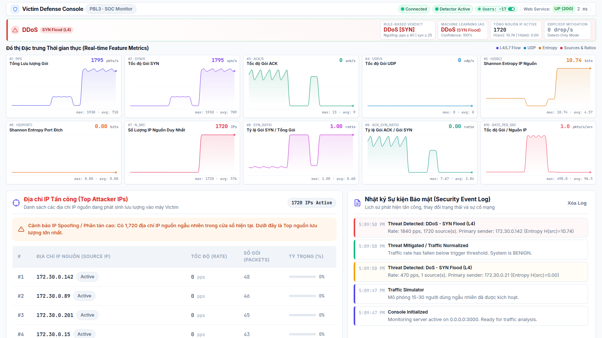
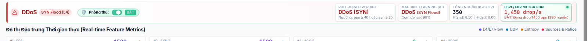
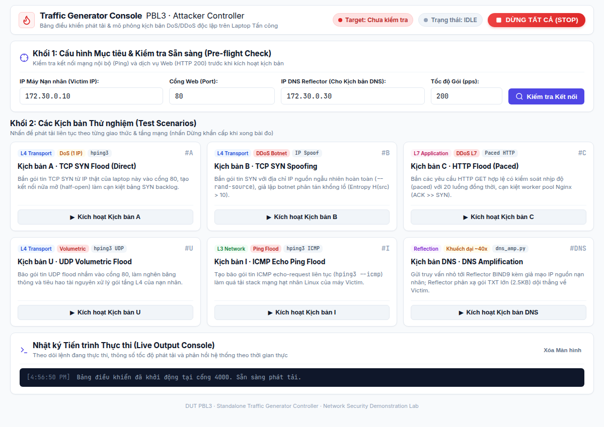

<p align="center">
  
</p>

# Phòng thí nghiệm Mô phỏng, Phát hiện Thời gian thực & Phòng thủ DoS/DDoS

Một hệ thống nghiên cứu và thực nghiệm toàn diện với hai chế độ triển khai (máy thật và Docker ảo hóa), tích hợp quy trình **mô phỏng tấn công**, **trích xuất 10 đặc trưng lưu lượng thời gian thực**, **phân loại song song bằng Luật ngưỡng và Học máy (Machine Learning)**, cùng cơ chế **giảm thiểu thiệt hại trực tiếp trong nhân hệ điều hành (In-Kernel Mitigation via eBPF/XDP)**. Đề tài đồ án cơ sở ngành PBL3 — Trường Đại học Bách khoa, Đại học Đà Nẵng (DUT).

Hệ thống quan sát lưu lượng mạng đến (inbound) theo các cửa sổ trượt độc lập 1 giây, tính toán liên tục 10 chỉ số thời gian thực bao gồm **Entropy Shannon của IP nguồn & cổng đích**, **số lượng IP nguồn phân biệt**, và **các tỷ lệ tương quan giao thức**. Hệ thống phân định chính xác giữa lưu lượng người dùng hợp lệ với tấn công từ một nguồn (**DoS**) và tấn công phân tán (**DDoS**), đồng thời nhận diện chính xác các vector tấn công qua **TCP SYN flood (L4)**, **UDP flood (L3/L4)**, **ICMP echo flood (L3)** và **HTTP flood (L7)**.

Hệ thống hỗ trợ sẵn hai môi trường triển khai:
1. **Môi trường mạng máy thật (Physical Multi-Machine Topology)**: Gồm 3 máy tính xách tay vật lý (1 Nạn nhân + 2 Kẻ tấn công) giao tiếp qua mạng WiFi/LAN nội bộ.
2. **Môi trường ảo hóa Docker Lab**: Mạng cầu nội bộ cô lập (`172.30.0.0/24`) với 1 máy nạn nhân, 6 nốt tấn công botnet và 1 mô-đun phát hiện.

---

## ⚠️ Khuyến cáo An toàn — Chỉ dành cho Nghiên cứu & Học tập

Dự án này được phát triển **hoàn toàn phục vụ mục đích giáo dục, học tập và nghiên cứu an toàn thông tin phòng thủ**. Toàn bộ các kịch bản tấn công chỉ được phép chạy nhắm vào chính máy nạn nhân được ủy quyền trong phòng thí nghiệm (trên dải mạng riêng Docker `172.30.0.0/24` hoặc trong mạng WiFi/LAN thử nghiệm cô lập).

- **TUYỆT ĐỐI KHÔNG** tấn công vào bất kỳ máy chủ, thiết bị mạng, trang web hoặc cơ sở hạ tầng nào mà không có sự cho phép bằng văn bản từ chủ sở hữu.
- Mọi hành vi tấn công từ chối dịch vụ không được cấp phép đều là **vi phạm pháp luật** theo Luật An toàn thông tin mạng tại Việt Nam và quốc tế.
- Nhóm tác giả **không chịu bất kỳ trách nhiệm pháp lý nào** đối với các hành vi lạm dụng hay sử dụng sai mục đích. Bạn hoàn toàn chịu trách nhiệm trước pháp luật về mọi hành động thực hiện bằng phần mềm này.

---

## Mục lục

- [Tổng quan hệ thống](#tổng-quan-hệ-thống)
- [Kiến trúc hệ thống](#kiến-trúc-hệ-thống)
  - [1. Môi trường mạng máy thật (WiFi / LAN)](#1-môi-trường-mạng-máy-thật-wifi--lan)
  - [2. Môi trường ảo hóa Docker Lab](#2-môi-trường-ảo-hóa-docker-lab)
- [Các vector tấn công (3 tầng mạng)](#các-vector-tấn-công-3-tầng-mạng)
- [Mô-đun phát hiện & Vector 10 đặc trưng thời gian thực](#mô-đun-phát-hiện--vector-10-đặc-trưng-thời-gian-thực)
- [Bảng điều khiển phòng thủ (Victim Defense Console)](#bảng-điều-khiển-phòng-thủ-victim-defense-console)
- [Quy trình Học máy (Machine Learning Pipeline)](#quy-trình-học-máy-machine-learning-pipeline)
  - [1. Đánh giá kiểm chuẩn cấp Luồng trên CICDDoS2019](#1-đánh-giá-kiểm-chuẩn-cấp-luồng-trên-cicddos2019)
  - [2. Mô hình cấp Cửa sổ thời gian thực (Window-Level Model)](#2-mô-hình-cấp-cửa-sổ-thời-gian-thực-window-level-model)
- [Cơ chế phòng thủ trong nhân Kernel (eBPF / XDP)](#cơ-chế-phòng-thủ-trong-nhân-kernel-ebpf--xdp)
- [Kết quả thực nghiệm](#kết-quả-thực-nghiệm)
- [Cài đặt & Hướng dẫn khởi chạy nhanh](#cài-đặt--hướng-dẫn-khởi-chạy-nhanh)
  - [Chế độ A: Demo mạng máy thật (WiFi / LAN)](#chế-độ-a-demo-mạng-máy-thật-wifi--lan)
  - [Chế độ B: Demo trên 1 máy bằng Docker Lab](#chế-độ-b-demo-trên-1-máy-bằng-docker-lab)
- [Cấu trúc mã nguồn](#cấu-trúc-mã-nguồn)
- [Hạn chế & Hướng phát triển](#hạn-chế--hướng-phát-triển)

---

## Tổng quan hệ thống

Hệ thống được tổ chức thành ba trụ cột hoạt động phối hợp:

1. **Mô-đun Phát sinh Tấn công (Attack Generation)**:
   - **L4 TCP SYN Flood**: Làm cạn kiệt bảng trạng thái kết nối nửa mở qua `hping3 -S -p 80` (hỗ trợ cờ `--rand-source` giả mạo hàng nghìn IP nguồn ngẫu nhiên).
   - **L3/L4 UDP Flood**: Làm nghẽn băng thông và cạn kiệt tài nguyên xử lý socket qua `hping3 --udp -p 80` (hỗ trợ `--rand-source`).
   - **L3 ICMP Echo Flood**: Làm nghẽn đường truyền mạng bằng bão gói tin ping qua `hping3 --icmp` hoặc `ping -f`.
   - **L7 HTTP Flood**: Làm tê liệt worker pool của máy chủ web qua ApacheBench `ab` (hỗ trợ kết nối đồng thời và HTTP Keep-Alive).
   - **DNS Amplification (phản xạ/khuếch đại)**: `attacks/dns_amp.py` gửi truy vấn DNS nhỏ (EDNS0) tới một reflector bind9, **giả mạo IP nguồn = victim**, khiến phản hồi lớn (~40–50×) dội về victim (gói UDP source-port 53).
2. **Mô-đun Phát hiện & Trích xuất Đặc trưng (Detection Engine)**:
   - Trích xuất định kỳ **10 đặc trưng cửa sổ** mỗi giây (`pps`, `syn_s`, `ack_s`, `udp_s`, `h_src`, `h_dport`, `n_src`, `syn_ratio`, `ack_syn_ratio`, `rate_per_src`) cùng bộ đếm `dns_s` (UDP source-port 53) để nhận diện DNS amplification.
   - Hỗ trợ cơ chế ngưỡng kép: **Ngưỡng cố định (Fixed rules)** hoặc **Ngưỡng thích nghi (Adaptive EWMA + MAD)** tự học theo đường cong lưu lượng nền.
   - Hai engine bắt gói: Không gian người dùng (**Scapy**) hoặc Không gian nhân Linux (**eBPF/XDP**) đạt tốc độ line-rate.
   - Phân loại song song bằng mô hình **Học máy Random Forest** nhúng trực tiếp.
3. **Bảng điều khiển phòng thủ (Victim Defense Console)**:
   - Giao diện web trực quan độc lập ([`dashboard/`](dashboard/)) chạy trực tiếp trên máy nạn nhân.
   - Hiển thị nhãn cảnh báo thời gian thực, 10 biểu đồ trượt sparkline, bảng phân tích Top IP tấn công kèm cờ cảnh báo giả mạo (Spoofed IP), nhật ký sự kiện an ninh và kiểm tra sức khỏe dịch vụ web (Service Health Probe).

---

## Kiến trúc hệ thống

### 1. Môi trường mạng máy thật (WiFi / LAN)

Thiết kế phục vụ các buổi báo cáo, thuyết trình thực tế bằng 3 laptop vật lý kết nối vào router WiFi hoặc switch mạng nội bộ:

```
                  Mạng WiFi / LAN riêng (vd: 192.168.1.0/24 qua DHCP)
        ┌─────────────────────────┬─────────────────────────┐
        │                         │                         │
        ▼                         ▼                         ▼
┌───────────────────┐     ┌──────────────┐          ┌──────────────┐
│    Máy Nạn nhân   │     │ Máy Tấn công │          │ Máy Tấn công │
│  (Victim Laptop)  │     │ (Attacker 1) │          │ (Attacker 2) │
│   192.168.1.50    │     │ 192.168.1.21 │          │ 192.168.1.22 │
├───────────────────┤     └──────────────┘          └──────────────┘
│ • Nginx Web (p80) │            │                         │
│ • detector.py     │            │                         │
│   (sniff wlan0)   │◄───────────┴─────────────────────────┘
│ • Defense Console │      Lưu lượng tấn công: SYN / UDP / HTTP
│   (:3000 Web UI)  │
└───────────────────┘
```

- **Victim Laptop** (`192.168.1.50`): Chạy Nginx (cổng 80), công cụ bắt gói `detector.py` trên giao diện mạng WiFi (`wlan0`/`wlp0s20f3`), và bảng điều khiển `node server.js` (cổng 3000).
- **Attacker Laptops** (`192.168.1.21`, `192.168.1.22`): Máy phát tải độc lập hoặc được điều phối tự động qua SSH bằng kịch bản `run_ddos_remote.sh`.

---

### 2. Môi trường ảo hóa Docker Lab

Môi trường tự động hóa cô lập hoàn toàn trên 1 máy tính đơn lẻ, thiết lập qua `docker-compose.yml`:

```
                       Cầu mạng Docker dos-lab (172.30.0.0/24)
        ┌───────────────────────┬───────────────────────┬───────────────┐
        │                       │                       │               │
        ▼                       ▼                       ▼               ▼
┌─────────────────┐     ┌───────────────┐       ┌───────────────┐       ┌───────────────┐
│ Container victim│     │  attacker1    │       │  attacker2    │  ...  │  attacker6    │
│  (172.30.0.10)  │     │ (172.30.0.21) │       │ (172.30.0.22) │       │ (172.30.0.26) │
│ • Nginx Server  │     └───────────────┘       └───────────────┘       └───────────────┘
│ • chung netns:  │             │                       │                       │
│   container     │◄────────────┴───────────────────────┴───────────────────────┘
│   detector      │          Lưu lượng tấn công tự động qua run_ddos.sh / run_demo.sh
└─────────────────┘
```

- **`victim`**: Chạy Nginx trên dải IP `172.30.0.10`, ánh xạ cổng `8080:80` ra máy chủ host.
- **`detector`**: Sử dụng chế độ mạng `network_mode: "service:victim"`, chia sẻ chung không gian mạng và card mạng `eth0` với victim để giám sát toàn bộ lưu lượng đến.
- **`attacker1` .. `attacker6`**: Các container botnet được cấp quyền raw socket (`NET_RAW`, `NET_ADMIN`) phục vụ các thử nghiệm tấn công quy mô lớn.
- **`dns`** (`172.30.0.30`): Máy chủ DNS reflector (bind9, zone `amp.lab` với bản ghi TXT lớn) phục vụ kịch bản **DNS Amplification**. Chỉ authoritative, **không recursion** → không phải open resolver thật, cô lập trong lab.

---

## Các vector tấn công (các tầng mạng)

1. **L4 TCP SYN Flood (Tầng giao vận)**: Khai thác cơ chế bắt tay ba bước của TCP. Kẻ tấn công gửi ồ ạt gói SYN nhưng không gửi gói ACK hoàn tất, làm đầy hàng đợi kết nối nửa mở (SYN queue / backlog) và từ chối các phiên truy cập mới từ người dùng thật.
2. **L3/L4 UDP Flood (Tầng mạng & Giao vận)**: Gửi khối lượng lớn gói tin UDP không hướng kết nối đến các cổng ngẫu nhiên, làm nghẽn toàn bộ băng thông và buộc máy nạn nhân tiêu hao CPU để sinh thông điệp ICMP Port Unreachable.
3. **L3 ICMP Echo Flood (Tầng mạng)**: Bơm lưu lượng ping cường độ tối đa (`hping3 --icmp` hoặc `ping -f`) nhằm bão hòa đường truyền vật lý của mạng nạn nhân.
4. **L7 HTTP Flood (Tầng ứng dụng)**: Mở hàng trăm kết nối TCP hoàn tất và liên tục gửi yêu cầu HTTP GET/POST với cờ Keep-Alive. Các yêu cầu này chiếm dụng toàn bộ worker thread trong pool xử lý của máy chủ web, khiến dịch vụ ngưng trệ dù băng thông mạng chưa cạn kiệt.
5. **DNS Amplification (Phản xạ & Khuếch đại)**: Gửi truy vấn DNS nhỏ (EDNS0) tới reflector `172.30.0.30`, **giả mạo IP nguồn = victim**, khiến reflector dội phản hồi lớn (~40–50×) về victim. Victim nhận gói UDP source-port 53; detector gắn nhãn `[DNS amp]`. Chặn **per-source** trị được (ít reflector thật). Chi tiết: [`docs/LyThuyet_DoS_DDoS.md`](docs/LyThuyet_DoS_DDoS.md) §3.4.

---

## Mô-đun phát hiện & Vector 10 đặc trưng thời gian thực

Mỗi giây, mô-đun phát hiện tổng hợp lưu lượng mạng đến thành một vector toán học 10 chiều:

```text
x = [pps, syn_s, ack_s, udp_s, H(src), H(dport), n_src, syn_ratio, ack_syn_ratio, rate_per_src]
```

```
          ┌────────────────────────────────────────────────────────┐
          │     Vector 10 đặc trưng trích xuất mỗi giây            │
          ├──────────────┬─────────────────────────┬───────────────┤
          │ Cường độ     │ Cấu trúc Giao thức      │ Phân tán Nguồn│
          ├──────────────┼─────────────────────────┼───────────────┤
          │ • pps        │ • syn_s    • syn_ratio  │ • n_src       │
          │ • udp_s      │ • ack_s    • ack_syn_rat│ • H(src)      │
          │              │                         │ • H(dport)    │
          │              │                         │ • rate_per_src│
          └──────────────┴─────────────────────────┴───────────────┘
```

### Công thức & Ý nghĩa các đặc trưng

1. **`pps`**: Tổng số gói tin vào máy nạn nhân trong 1 giây (đo cường độ lưu lượng).
2. **`syn_s`**: Số gói TCP mang cờ SYN/giây (chỉ số chính nhận diện tấn công kết nối nửa mở).
3. **`ack_s`**: Số gói TCP mang cờ ACK/giây (xác nhận các kết nối TCP đã hoàn tất bắt tay).
4. **`udp_s`**: Số gói tin giao thức UDP/giây (phục vụ nhận dạng tấn công UDP flood).
5. **`h_src` (Entropy IP nguồn - `H(src)`):** Entropy Shannon của phân bố địa chỉ IP nguồn:
   $$H = -\sum_{i=1}^{n} p_i \log_2(p_i)$$
   Đo mức độ phân tán của nguồn gửi: 1 nguồn đơn lẻ có `H(src) = 0`; 6 botnet phân bố đều có `H(src) ≈ 2.58`; IP spoofing ngẫu nhiên có `H(src) > 10.6` bits.
6. **`h_dport` (Entropy cổng đích - `H(dport)`):** Entropy Shannon của phân bố cổng đích, giúp phân biệt tấn công dịch vụ cụ thể (`H ≈ 0`) với quét cổng ngẫu nhiên (`H` cao).
7. **`n_src`**: Số địa chỉ IP nguồn phân biệt ghi nhận trong cửa sổ 1 giây.
8. **`syn_ratio`**: Tỷ lệ cờ SYN trên tổng số gói: `syn_s / max(pps, 1.0)` (tiệm cận 1.0 khi bị SYN flood).
9. **`ack_syn_ratio`**: Tỷ lệ cờ ACK trên cờ SYN: `ack_s / max(syn_s, 1.0)` (`>> 1.0` khi HTTP flood, `≈ 0` khi SYN flood).
10. **`rate_per_src`**: Tốc độ gói trung bình trên mỗi nguồn: `pps / max(n_src, 1)` — **Đặc trưng quyết định giúp phân biệt Flash Crowd với DDoS Botnet**.

### Quy tắc Phân loại (Luật Ngưỡng)

1. **Kích hoạt Cảnh báo (Trigger)**: Bật cảnh báo khi `pps >= threshold` HOẶC `syn_s >= syn_threshold`.
2. **Phân biệt DoS vs DDoS**:
   - Nhận định là **DDoS** nếu `n_src >= ddos_min_src` (mặc định 10 - có dấu hiệu IP Spoofing hoặc hàng loạt botnet) HOẶC (`n_src >= 2` VÀ tỷ lệ lưu lượng của nguồn lớn nhất `top_share < 0.8` — không có nguồn nào áp đảo).
   - Nhận định là **DoS** nếu một nguồn chiếm đa số lưu lượng (`top_share ≈ 1.0`, `H(src) ≈ 0`).
3. **Gắn nhãn Vector Tấn công**:
   - `[SYN flood]`: Khi `syn_s` vượt ngưỡng và `ack_s < syn_s * 0.2`.
   - `[UDP flood]`: Khi `udp_s >= pps_threshold` và `udp_s > syn_s`.
   - `[HTTP flood]`: Khi `pps` cao và `ack_s >> syn_s` (`ack_syn_ratio >> 1.0`).

---

## Bảng điều khiển phòng thủ (Victim Defense Console)

Giao diện web giám sát chuyên dụng ([`dashboard/`](dashboard/)) chạy trực tiếp trên máy nạn nhân, truyền tải thông số an ninh mạng theo thời gian thực:

<p align="center">
  
</p>

### Tính năng Nổi bật

- **Banner Trạng thái Cảnh báo & Thanh gạt Phòng thủ IPS Động**: Đổi màu trực quan tức thì (`BENIGN` - Xanh lá, `DoS` - Màu cam, `DDoS` - Màu đỏ) kèm nhãn vector tấn công (`[SYN flood]`, `[UDP flood]`, `[HTTP flood]`, `[DNS amp]`) và độ tự tin AI (ML Confidence).
  - Tích hợp **Thanh trượt công tắc phòng thủ eBPF/XDP IPS (`[🛡️ Phòng thủ: BẬT / TẮT]`)** ngay trên banner: Cho phép chuyển đổi tức thì giữa chế độ chỉ giám sát (Detect-Only) và chế độ phòng thủ chủ động (Closed-loop IPS) trực tiếp tại card mạng Linux Kernel mà không cần khởi động lại tiến trình!
<p align="center">
  
</p>

- **Hộp thông số Giảm thiểu thiệt hại (eBPF/XDP Mitigation)**: Hiển thị trực tiếp số gói tin bị loại bỏ theo thời gian thực (`drop/s`), trạng thái danh sách chặn nguồn (blocklist TTL) và đèn báo hoạt động.
- **Service Health Probe**: Định kỳ kiểm tra tình trạng dịch vụ Nginx mỗi 2.5 giây, đo đạc độ trễ phản hồi (ms) và mã trạng thái HTTP (200 OK / Timeout).
- **11 Biểu đồ Trượt Sparkline Canvas (Bố cục 4-4-3)**: Trực quan hóa biến thiên liên tục trong 60 giây của toàn bộ 10 đặc trưng mạng cùng chỉ số thứ 11 **`DNS/s`** (UDP source-port 53) phát hiện phản xạ DNS.
- **Bảng Top Attacker IPs**: Xếp hạng các địa chỉ IP phát tải lớn nhất, tính toán tỷ lệ đóng góp lưu lượng và tự động gắn nhãn cảnh báo **SPOOFED IP** khi phát hiện địa chỉ nguồn ngẫu nhiên.
- **Nhật ký Sự kiện An ninh (Event Log)**: Ghi nhận có thứ tự thời gian các sự kiện an ninh mạng theo từng cấp độ cảnh báo (`safe`, `warn`, `crit`, `info`).

---

## Bảng điều khiển phát tải Tấn công (Attacker Traffic Generator Console)

Nhằm tối ưu hóa trải nghiệm thực nghiệm trên máy thật (không cần gõ dòng lệnh phức tạp trong lúc thuyết trình), dự án trang bị bảng điều khiển web độc lập ([`attacker_dashboard/`](attacker_dashboard/)) dành riêng cho các máy thử nghiệm tải:

<p align="center">
  
</p>

- **Khối 1: Pre-flight Target Check**: Nhập IP/Port máy Victim và IP máy DNS Reflector, sau đó nhấn **[🔍 Kiểm tra Kết nối]** để probe tự động bằng Ping ICMP và HTTP GET. Đèn báo xanh `🟢 SẴN SÀNG: Ping OK | HTTP 200 OK` xác nhận kết nối mạng đã thông suốt.
- **Khối 2: 6 Kịch bản Bắn tải Đo đạc (1-Click Trigger)**:
  - **A: SYN Flood (Direct IP)** — Tấn công DoS L4 đơn nguồn vào cổng 80.
  - **B: SYN Flood (Spoofed IPs)** — Tấn công DDoS L4 đa nguồn giả mạo ngẫu nhiên (`--rand-source`).
  - **C: HTTP Flood (Paced)** — Tấn công DoS/DDoS L7 nhịp độ cao làm nghẽn worker pool web server.
  - **U: UDP Volumetric Flood** — Tấn công volumetric UDP bào mòn băng thông mạng.
  - **I: ICMP Ping Flood** — Tấn công dồn dập gói tin ping L3.
  - **DNS: Amplification (Reflection)** — Tấn công phản xạ & khuếch đại DNS qua Reflector BIND9.
- **Khối 3: Nút Dừng Khẩn cấp [🛑 STOP ALL TRAFFIC]**: Hủy ngay lập tức toàn bộ các tiến trình tấn công nền (`hping3`, `http_flood.py`, `dns_amp.py`) chỉ với một cú nhấp chuột.
- **Khối 4: Live Output Terminal**: Console tối màu hiển thị trực tiếp đầu ra stdout/stderr thời gian thực qua WebSocket.

---

## Quy trình Học máy (Machine Learning Pipeline)

Dự án tiếp cận bài toán học máy theo hai giai đoạn rõ ràng:

### 1. Đánh giá kiểm chuẩn cấp Luồng trên CICDDoS2019

Ở giai đoạn đầu, nhóm thực hiện đánh giá kiểm chuẩn trên bộ dữ liệu quốc tế **CICDDoS2019** (~131,000 luồng hai chiều, 63 đặc trưng CICFlowMeter):
- **Phát hiện nhị phân**: Luật ngưỡng đơn đạt `F1 ≈ 0.60`, trong khi Random Forest đạt `F1 ≈ 0.999` (Độ chính xác 99.9%).
- **Hạn chế cố hữu**: Tiếp cận cấp luồng (Flow-level) đòi hỏi phải đợi luồng kết thúc và phải duy trì bảng trạng thái kết nối khổng lồ trong bộ nhớ RAM, rất dễ bị chính các cuộc tấn công tràn bảng trạng thái (state exhaustion) làm sập hệ thống. Điều này thôi thúc nhóm phát triển mô hình cấp Cửa sổ thời gian thực.

### 2. Mô hình cấp Cửa sổ thời gian thực (Window-Level Model)

Nhóm xây dựng quy trình thu thập dữ liệu cửa sổ trực tiếp từ card mạng bằng [`ml/pcap_to_windows.py`](ml/pcap_to_windows.py) dựa trên module đặc trưng dùng chung [`detection/window_features.py`](detection/window_features.py):
- **Cửa sổ trượt gối đầu**: Cửa sổ 1.0 giây, bước nhảy 0.5 giây.
- **Phương pháp đánh giá LORO (Leave-One-Run-Out)**: Tuyệt đối không dùng phép chia ngẫu nhiên 70/30 (tránh hiện tượng **rò rỉ dữ liệu - Data Leakage** giữa các cửa sổ liền kề). Mô hình được đánh giá độc lập trên từng file PCAP hoàn chỉnh.
- **Xử lý triệt để các trường hợp biên khó (Edge Cases)**:
  - **Tấn công cường độ thấp (Low-Rate SYN flood pps = 15, Kịch bản D)**: Luật ngưỡng bỏ sót 100%, mô hình Học máy phát hiện chính xác 100% nhờ nhận ra `syn_ratio ≈ 1.0` và `ack_s = 0`.
  - **Người dùng hợp lệ tải cao (Flash Crowd, Kịch bản E)**: Tốc độ gói vượt ngưỡng khiến luật báo nhầm; mô hình Học máy nhận diện đúng là `BENIGN` nhờ `n_src = 1`, `ack_s >> syn_s` và `rate_per_src` hợp lệ.

---

## Cơ chế phòng thủ trong nhân Kernel (eBPF / XDP)

Nhằm đáp ứng yêu cầu xử lý ở tốc độ dây (line-rate), mô-đun phát hiện tích hợp engine eBPF ([`detection/ebpf_counter.py`](detection/ebpf_counter.py)) chạy tại tầng XDP (eXpress Data Path) bên trong Linux kernel:

1. **Đếm gói siêu tốc tại Kernel Space**:
   - Gói tin đến được trích xuất thông tin và đếm trực tiếp trong bộ nhớ kernel thông qua các BPF maps trước khi hệ điều hành cấp phát bộ nhớ `sk_buff` (`XDP_PASS`).
   - Trong bài kiểm thử bão gói 120,000 pps, Scapy bị rớt gói nặng (chỉ bắt được 57%), trong khi eBPF đếm chính xác **95%** ở tốc độ line-rate.
2. **Cơ chế Chặn gói Tự động (Closed-Loop Blocking `--block`)**:
   - **Chặn theo tốc độ nguồn (Per-Source Rate Blocking)**: Bất kỳ IP nguồn nào gửi vượt quá ngưỡng `--block-pps` (ví dụ 300 pps) sẽ bị tự động đưa vào BPF map `blocklist`. Các gói tin tiếp theo từ IP này bị hủy ngay lập tức tại driver mạng (`XDP_DROP`).
   - **Tự động mở khóa (Auto-Expiring TTL `--block-ttl`)**: Mỗi mục trong danh sách chặn tự hết hạn sau một khoảng thời gian (ví dụ 5 giây), tránh việc khóa vĩnh viễn địa chỉ IP.
   - **Token Bucket toàn cục theo giao thức (`--block-syn-rate` / `--block-udp-rate` / `--block-icmp-rate`)**: Khi gặp tấn công giả mạo ngẫu nhiên hàng nghìn IP (không thể chặn theo từng IP cụ thể), cơ chế token bucket trong kernel cắt bỏ phần lưu lượng vượt định mức **theo từng giao thức** — SYN cho SYN flood, UDP cho UDP flood, ICMP cho ICMP flood — bảo vệ hàng đợi kết nối và băng thông của máy chủ. Đo trong lab: `--block-udp-rate 1000` chặn **~90%** UDP flood spoof 6 nguồn; `--block-icmp-rate 500` chặn **~95%** ICMP flood spoof. Đánh đổi: một phần lưu lượng hợp lệ cùng giao thức cũng bị rớt khi vượt ngưỡng.

---

## Kết quả thực nghiệm

### Bảng kiểm chứng các kịch bản tiêu chuẩn

| Kịch bản | Vector tấn công | Tốc độ | n_src | H(src) | Kết luận Luật | Kết luận Học máy (AI) |
|---|---|---|---|---|---|---|
| **Benign** | Người dùng duyệt web (~16 users) | ~21 pps | 4 | 2.00 | **BENIGN** | **BENIGN (79%)** |
| **A** | DoS TCP SYN Flood (1 nguồn) | ~1094 pps | 1 | 0.00 | **DoS `[SYN flood]`** | **DoS (59%)** |
| **B** | DDoS TCP SYN Flood (Spoofing) | ~1616 pps | 1616 | 10.66 | **DDoS `[SYN flood]`** | **DDoS (100%)** |
| **UDP DoS (U_dos)**| DoS UDP Flood (1 nguồn) | ~430 pps | 1 | 0.00 | **DoS `[UDP flood]`** | **DoS (58%)** |
| **UDP DDoS (U)**| DDoS UDP Flood (Spoofing) | ~2750 pps | ~2750 | 11.45 | **DDoS `[UDP flood]`** | **DDoS (99%)** |
| **ICMP (I)** | DDoS ICMP Ping Flood | ~2700 pps | ~2700 | 11.40 | **DDoS (nhiều nguồn)**| **DDoS (99%)** |
| **C** | DDoS HTTP Flood (L7 6 nốt) | ~2012 pps | 6 | 2.58 | **DDoS `[HTTP (L7)]`**| **DDoS (88%)** |
| **D** | Low-Rate SYN Flood (Ẩn dưới ngưỡng) | ~24 pps | ~20 | ~4.2 | Bỏ sót (0%) | **DDoS (100%)** |
| **E** | Flash Crowd (Tải cao đột biến) | ~350 pps | 1 | 0.00 | Báo nhầm (DoS) | **BENIGN (100%)** |

> [!NOTE]
> Toàn bộ dữ liệu đo đạc thực nghiệm chi tiết (`.csv`), nhãn mác kiểm chứng thực địa (`.meta.json`) và biểu đồ trực quan hóa dòng thời gian (`.png`) được lưu trữ đầy đủ tại thư mục [`results/final/`](results/final/):
> - **L3 ICMP**: [`results/final/I.csv`](results/final/I.csv) & [`results/final/I.png`](results/final/I.png)
> - **L4 UDP**: [`results/final/U_dos.csv`](results/final/U_dos.csv) (DoS 1 nguồn) & [`results/final/U.csv`](results/final/U.csv) (DDoS spoofing) kèm đồ thị [`U_dos.png`](results/final/U_dos.png), [`U.png`](results/final/U.png)
> - **L4 TCP SYN**: [`results/final/A.csv`](results/final/A.csv) & [`results/final/B.csv`](results/final/B.csv) kèm đồ thị [`A.png`](results/final/A.png), [`B.png`](results/final/B.png)
> - **L7 HTTP**: [`results/final/C.csv`](results/final/C.csv) & đồ thị [`C.png`](results/final/C.png)
> - **Edge cases**: [`results/final/D.csv`](results/final/D.csv) (Low-rate) & [`results/final/E.csv`](results/final/E.csv) (Flash crowd) kèm đồ thị [`D.png`](results/final/D.png), [`E.png`](results/final/E.png)

---

## Cài đặt & Hướng dẫn khởi chạy nhanh

### Chế độ A: Demo mạng máy thật (WiFi / LAN)

Mô hình gồm **3 laptop thật** kết nối chung 1 mạng Wi-Fi (hoặc Hotspot 4G phát từ điện thoại): **1 Victim + 2 Attacker**.
> 📄 **Tài liệu hướng dẫn in ấn**: Xem file cẩm nang in ấn tóm tắt [`HUONG_DAN_DEMO_3_MAY.pdf`](HUONG_DAN_DEMO_3_MAY.pdf) và tài liệu chi tiết tại [`docs/MULTI_MACHINE.md`](docs/MULTI_MACHINE.md).

#### Bước 0: Đồng bộ mã nguồn mới nhất trên CẢ 3 Máy
```bash
cd ~/dos-ddos-project && git pull origin main
```
Xác định địa chỉ IP và card mạng của từng máy bằng lệnh `hostname -I` hoặc `ip -brief addr` (ví dụ: Victim `192.168.1.100`, Attacker 1 `192.168.1.50`, Attacker 2 `192.168.1.51`).

#### Bước 1: Thiết lập trên Máy Nạn nhân (Victim Laptop — Kết nối Máy chiếu)
```bash
# 1. Bật Web Server Nginx cổng 80 (Docker hoặc cài trực tiếp):
docker run -d --name victim_web -p 80:80 nginx:alpine
# hoặc: sudo systemctl start nginx

# 2. Khởi chạy Bộ dò kép & Dashboard SOC Console:
cd ~/dos-ddos-project
sudo .venv/bin/python3 detection/detector.py \
    --iface wlan0 \
    --victim 192.168.1.100 \
    --pps 40 --syn 25 \
    --ml detection/window_model.joblib \
    --stream | node dashboard/server.js --victim 192.168.1.100
```
Mở trình duyệt truy cập: **`http://localhost:3000`** (bấm F11 để chiếu toàn màn hình hiển thị 11 đồ thị sóng trực tiếp và thanh gạt phòng thủ IPS).

#### Bước 2: Thiết lập trên Hai Máy Tấn công (Attacker Laptops)
- **Trên Laptop Attacker 1 (kiêm DNS Reflector):**
  ```bash
  # 1. Khởi chạy DNS Reflector BIND9 cổng 53 (chỉ cần chạy 1 lần):
  cd ~/dos-ddos-project/dns && docker run -d --name dns_reflector -p 53:53/udp $(docker build -q .)

  # 2. Khởi chạy Traffic Generator Console:
  cd ~/dos-ddos-project/attacker_dashboard && node server.js --port 4000
  ```
- **Trên Laptop Attacker 2:**
  ```bash
  cd ~/dos-ddos-project/attacker_dashboard && node server.js --port 4000
  ```
- **Thao tác trên giao diện Web `http://localhost:4000` của cả 2 máy Attacker:**
  1. Nhập **Target Victim IP:** `192.168.1.100` | **Port:** `80`.
  2. Nhập **DNS Reflector IP:** `192.168.1.50` (IP Wi-Fi của máy Attacker 1).
  3. Bấm nút **[🔍 Kiểm tra Kết nối]**: Đèn xanh `🟢 SẴN SÀNG: Ping OK | HTTP 200 OK` báo hiệu đã thông mạng và sẵn sàng phát tải.

#### Bước 3: Kịch bản Trình diễn 4 Pha trước Hội đồng
1. **Pha 1 (Trạng thái Bình thường - Baseline)**: Cả 2 Attacker chưa bấm gì. Victim hiển thị `BENIGN (An toàn)`, 11 đồ thị phẳng lặng (0–10 pps), Web Service: `UP (200) 1ms`. Thanh trượt phòng thủ ở trạng thái `[🛡️ Phòng thủ: TẮT]`.
2. **Pha 2 (Tấn công DoS đơn nguồn)**: Attacker 1 bấm `[Kịch bản A: SYN Direct]` &rarr; Victim đổi banner cam `DoS [SYN flood]`, `n_src = 1`, `H(src) ≈ 0.00`. Sau đó Attacker 1 bấm `[STOP ALL TRAFFIC]` để hệ thống tự động hạ nhiệt về `BENIGN`.
3. **Pha 3 (Tấn công DDoS đa nguồn & DNS Amplification)**: Attacker 1 bấm `[Kịch bản B: SYN Spoofed]`, Attacker 2 bấm `[Kịch bản C: HTTP Paced]` hoặc `[Kịch bản DNS: Amplification]` &rarr; Victim đổi banner đỏ rực `DDoS`, `n_src` tăng vọt lên hàng trăm/nghìn IP, `H(src) > 7.0–8.0 bits`, đồ thị `DNS/s` tăng cao, Web Service bị nghẽn (`SLOW` / `ERR / TIMEOUT`).
4. **Pha 4 (Kích hoạt Phòng thủ Closed-loop IPS — Đắt giá nhất)**: Ngay trên màn hình máy chiếu, dùng chuột **gạt thanh trượt [🛡️ Phòng thủ: BẬT]** &rarr; eBPF/XDP kích hoạt `XDP_DROP` tại card mạng, số đếm `drop/s` nhảy vọt lên hàng nghìn gói/giây, Web Service của Victim lập tức hồi sinh: **`UP (200) 1ms`** trước mắt Thầy Cô!

---

### Chế độ B: Demo trên 1 máy bằng Docker Lab

#### Bước 1: Khởi động hệ thống container
```bash
cd ~/dos-ddos-project
docker compose up -d --build
docker compose ps
```

#### Bước 2: Mở 2 Terminal để thực hiện Demo

* **Terminal 1: Chạy Detector AI & Dashboard Console**
  ```bash
  cd ~/dos-ddos-project
  docker exec -i detector python3 /app/detector.py --victim 172.30.0.10 --pps 40 --syn 25 --ml /app/window_model.joblib --stream | node dashboard/server.js --victim 172.30.0.10
  ```
  Truy cập giao diện Web tại: **`http://localhost:3000`**.

* **Terminal 2: Chạy kịch bản tự động diễn tập 6 pha tấn công**
  ```bash
  cd ~/dos-ddos-project
  ./run_demo.sh
  ```

---

## Cấu trúc mã nguồn

```
.
├── banner.svg                    # Đồ họa minh họa kiến trúc và vector đặc trưng
├── docker-compose.yml            # Định nghĩa hệ thống container ảo hóa mạng dos-lab
├── run_demo.sh                   # Kịch bản tự động chạy diễn tập 6 pha tấn công demo
├── run_ddos.sh                   # Script điều phối tấn công trong Docker (6 botnet)
├── run_ddos_remote.sh            # Script điều phối tấn công từ xa qua SSH cho máy thật
│
├── attacks/                      # Công cụ và kịch bản phát sinh lưu lượng
│   ├── benign_dynamic_users.py   # Mô phỏng người dùng duyệt web thực tế ngẫu nhiên
│   ├── benign_gen.py             # Sinh lưu lượng nền hợp lệ phục vụ tập dữ liệu
│   └── http_flood.py             # Kịch bản phát tải HTTP paced có điều tiết nhịp
│
├── detection/                    # Mô-đun phân tích lưu lượng & phát hiện thời gian thực
│   ├── Dockerfile                # Image container detector (Ubuntu + BCC + scikit-learn)
│   ├── detector.py               # Detector 10 đặc trưng (Rule, Adaptive, ML, Stream JSON)
│   ├── ebpf_counter.py           # Engine eBPF/XDP đếm gói và hủy gói trong kernel
│   ├── window_features.py        # Nguồn chân lý chuẩn hóa công thức tính 10 đặc trưng
│   └── window_model.joblib       # Mô hình Random Forest đã huấn luyện phục vụ suy luận live
│
├── dashboard/                    # Bảng điều khiển phòng thủ Victim Defense Console
│   ├── package.json              # Khai báo phụ thuộc (Express, WebSocket)
│   ├── server.js                 # Backend Node.js (đọc stream stdin, REST API, probe Nginx)
│   └── public/                   # Giao diện web người dùng (11 charts, IPS toggle, banner, logs)
│
├── attacker_dashboard/           # Bảng điều khiển phát tải Tấn công (Attacker Console :4000)
│   ├── package.json              # Khai báo phụ thuộc (Express, WebSocket)
│   ├── server.js                 # Backend Node.js (Pre-flight probe, trigger 6 kịch bản, stop)
│   └── public/                   # Giao diện web người dùng cho 2 laptop Attacker
│
├── dns/                          # Container DNS Reflector BIND9 phục vụ kịch bản DNS Amplification
│   ├── Dockerfile                # Image Ubuntu + bind9
│   └── named.conf                # Cấu hình authoritative zone amp.lab (bản ghi TXT lớn 3.5KB)
│
├── ml/                           # Quy trình nghiên cứu và huấn luyện Học máy
│   ├── pcap_to_windows.py        # Trích xuất đặc trưng có nhãn từ file PCAP theo timeline
│   ├── build_window_dataset.py   # Tổng hợp tập dữ liệu cửa sổ từ log CSV của detector
│   └── train_window.py           # Huấn luyện mô hình Random Forest cửa sổ (LORO, 10 đặc trưng)
│
├── experiments/                  # Kịch bản thực nghiệm và đánh giá kiểm chứng
│   ├── run_scenarios.py          # Chạy tự động các kịch bản đo đạc A/B/C/D/E
│   ├── run_dashboard_demo.py     # Điều phối 6 pha tấn công cuồng nộ và pha hạ nhiệt
│   ├── adaptive_eval.py          # So sánh hiệu quả giữa ngưỡng cố định và ngưỡng thích nghi
│   └── capture_session.py        # Bắt gói PCAP kết hợp đồng hồ mốc timeline cho ML
│
├── analysis/                     # Tiện ích phân tích và biểu đồ hóa sau thực nghiệm
│   ├── metrics.py                # Tính toán độ trễ phát hiện, Precision, Recall, F1
│   └── plot_attack.py            # Vẽ đồ thị diễn biến lưu lượng từ file log CSV
│
├── results/final/                # Dữ liệu đo đạc CSV và hình ảnh biểu đồ chính thức
└── docs/                         # Tài liệu thuyết minh lý thuyết và hướng dẫn kỹ thuật
    ├── LyThuyet_DoS_DDoS.md      # Cẩm nang lý thuyết toàn diện về tấn công & phát hiện
    ├── MULTI_MACHINE.md          # Hướng dẫn chi tiết thiết lập bài lab 3 máy thật qua WiFi
    └── TESTING.md                # Quy trình kiểm thử, xác minh và tái lập kết quả
```

---

## Hạn chế & Hướng phát triển

- **Thách thức khi gặp IP Spoofing**: Một máy đơn lẻ khi giả mạo địa chỉ IP ngẫu nhiên sẽ tạo ra chữ ký lưu lượng tương tự như hàng nghìn máy botnet phân tán thật đến card mạng nạn nhân.
- **Tấn công cường độ thấp dạng kéo dài (Low-and-Slow)**: Các ngưỡng thể tích tập trung vào cường độ gói tin, chưa tối ưu đối với các đòn tấn công làm cạn kiệt tài nguyên chậm ở tầng ứng dụng (như Slowloris hay slow-read).
- **Giới hạn bão hòa đường truyền vật lý**: Cơ chế phòng thủ tại máy chủ (kể cả eBPF/XDP) chỉ bảo vệ được tài nguyên tính toán của máy chủ nhưng không thể ngăn chặn việc bão hòa băng thông đường truyền từ phía nhà cung cấp mạng (ISP); các đòn tấn công thể tích lớn (hàng chục Gbps) cần được xử lý ở các trung tâm lọc rửa (Scrubbing Centers) hoặc qua giao thức BGP Flowspec.
- **Hướng phát triển tương lai**: Nghiên cứu tích hợp thuật toán phát hiện điểm đổi CUSUM, mở rộng theo dõi luồng qua kiến trúc P4/eBPF, và nghiên cứu học tăng cường thích nghi trong phòng thủ mạng.

---
*Đề tài nghiên cứu và thực hiện phục vụ học phần Đồ án Cơ sở Ngành PBL3 — An toàn Thông tin & Phòng thủ Mạng, Trường Đại học Bách khoa, Đại học Đà Nẵng.*
