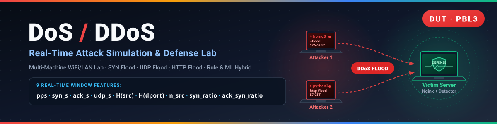
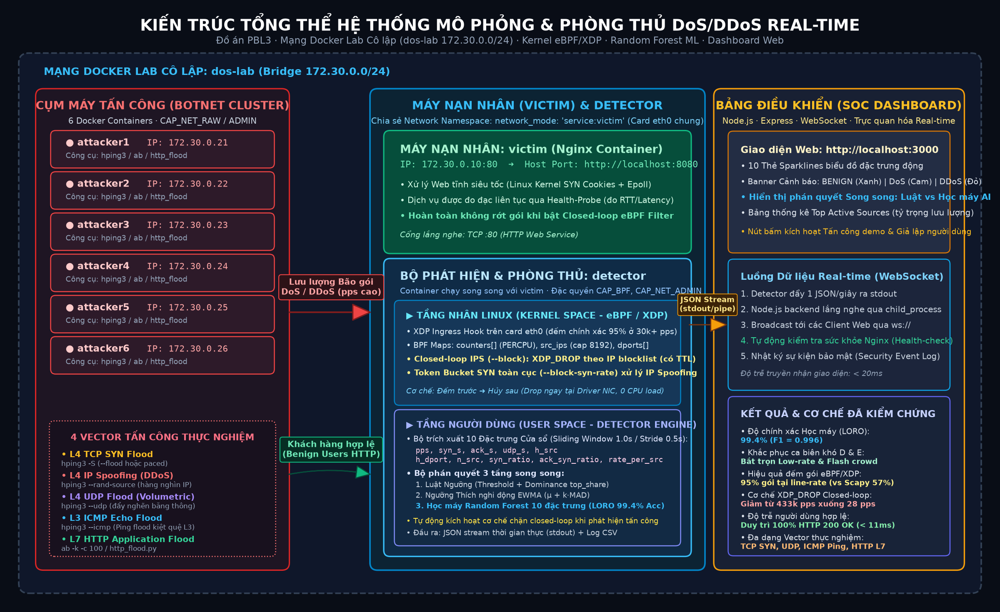
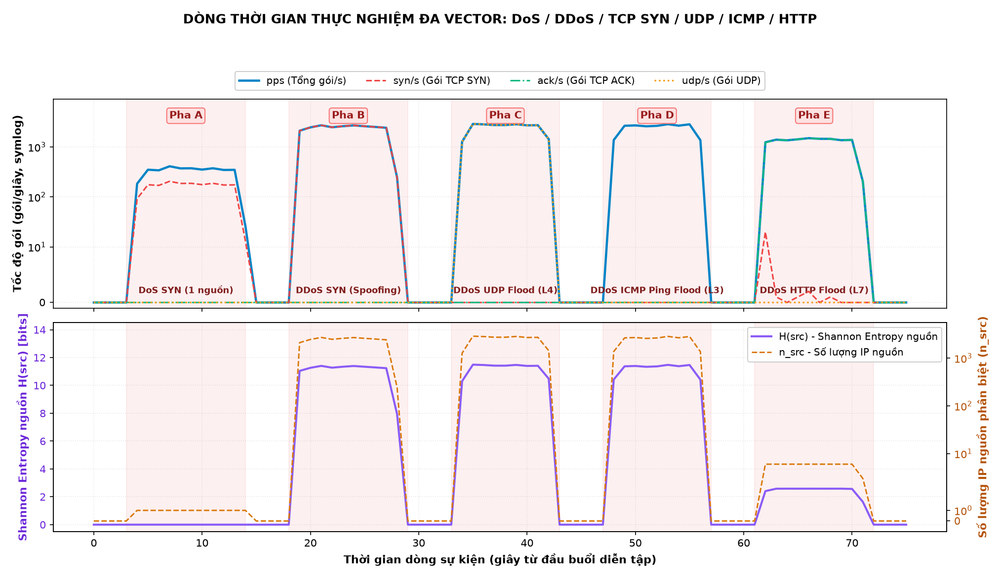
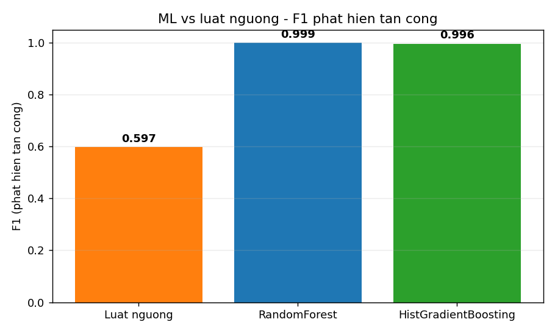

<p align="center">
  
</p>

# DoS/DDoS Attack Simulation & Detection Lab

A self-contained, Docker-based lab that **simulates** DoS/DDoS attacks and **detects and
classifies** them in real time. Built as an end-of-term project (DUT — PBL3).

The detector observes traffic in one-second windows and combines simple rate thresholds with
**Shannon entropy of source IPs** and **distinct-source counting** to tell a single-source
**DoS** apart from a multi-source **DDoS**, and an L4 **SYN flood** apart from an L7 **HTTP flood**.

---

## ⚠️ Disclaimer — Educational use only

This project is provided **strictly for education and defensive research inside a fully
isolated laboratory**. The attack scripts must only ever target the lab's own `victim`
container on the private `172.30.0.0/24` network.

- **Do NOT** point these tools at any host, network, or service you do not own or lack
  explicit written permission to test.
- Denial-of-service attacks against systems without authorization are **illegal** in most
  jurisdictions.
- The authors accept **no liability** for misuse. You are solely responsible for how you use
  this code.

---

## Table of Contents

- [Overview](#overview)
- [Lab Architecture](#lab-architecture)
- [Requirements](#requirements)
- [Installation](#installation)
- [Usage](#usage)
- [Detection Mechanism](#detection-mechanism)
- [Results](#results)
- [Project Structure](#project-structure)
- [Limitations](#limitations)
- [Development](#development)

## Overview

The project has two halves that run against each other in an isolated network:

1. **Attack side** — SYN flood (L4) and HTTP flood (L7) scripts, optionally with IP spoofing,
   driven from one to six attacker containers.
2. **Detection side** — a real-time sniffer that reports per-second traffic features and raises
   classified alerts (`DoS` / `DDoS`, with a `[SYN flood]` tag when applicable).

## Lab Architecture



All services share one isolated bridge network, `dos-lab` (`172.30.0.0/24`):

| Container   | Image / Build      | IP            | Role                                                        |
|-------------|--------------------|---------------|-------------------------------------------------------------|
| `victim`    | `nginx:alpine`     | 172.30.0.10   | Target web server, published to `localhost:8080`            |
| `attacker1` | `./attacker`       | 172.30.0.21   | Attack source (scapy + hping3 + ab), `NET_RAW` + `NET_ADMIN` |
| `attacker2`–`attacker6` | `./attacker` | 172.30.0.22–26 | Attack sources (6 total → an L7 DDoS shows 6 real sources)  |
| `detector`  | `./detection`       | shares victim | Sniffs the victim's `eth0` (`network_mode: service:victim`) |

The detector builds from its **own** image (`detection/Dockerfile`: ubuntu + `python3-bpfcc` for the
eBPF/XDP counting engine + pinned `scikit-learn`/`joblib` for `--ml`), with `CAP_BPF`/`CAP_PERFMON`/
`CAP_NET_ADMIN` and read-only mounts of `/lib/modules`, `/usr/src`, `/sys/kernel/debug` so BCC can
compile the XDP program at runtime. It shares the victim's network namespace, so it sees exactly the
traffic the victim sees. Attack and detection scripts are **bind-mounted**, so edits take effect on
the next `docker exec` without rebuilding images.

## Requirements

- **Linux** (native Docker — no WSL2/Docker Desktop needed; the eBPF engine attaches a kernel XDP
  program, so it needs a Linux host).
- **Python 3.11+** on the host with **matplotlib**, for the analysis/plotting scripts only
  (everything else runs inside containers):

  ```bash
  pip install matplotlib
  ```

## Installation

```bash
git clone <your-private-repo-url> dos-ddos-project
cd dos-ddos-project
docker compose up -d --build      # build images and start all containers
docker compose ps                 # verify: victim, detector, attacker1..6 are Up
```

Open `http://localhost:8080` to confirm the victim web server responds.

## Usage

> Run the attack phases only against the lab's `victim`. See the disclaimer above.

**1. Start the detector** (in its own terminal):

```bash
docker exec -it detector python3 /app/detector.py \
  --pps 40 --syn 25 --victim 172.30.0.10 --csv /app/attack.csv

# Adaptive thresholds (EWMA): learns the baseline; --pps/--syn act as a safety floor
docker exec -it detector python3 /app/detector.py --adaptive --victim 172.30.0.10 --csv /app/attack.csv

# Live ML alongside the rule: classify each window with a trained model, show both verdicts
# (needs ml/train_window.py to have produced detection/window_model.joblib first)
docker exec -it detector python3 /app/detector.py \
  --pps 40 --syn 25 --victim 172.30.0.10 --ml /app/window_model.joblib

# eBPF/XDP counting engine (accurate at line-rate; scapy drops packets above a few k pps)
docker exec -it detector python3 /app/detector.py --engine ebpf --victim 172.30.0.10

# Closed-loop blocking (detect -> XDP_DROP), needs --engine ebpf; off by default
docker exec -it detector python3 /app/detector.py --engine ebpf --block \
  --block-pps 200 --block-ttl 5 --block-syn-rate 2000 --victim 172.30.0.10
```

**2. Launch a single attack** (another terminal):

```bash
# SYN flood (L4), with IP spoofing
docker exec attacker1 python3 /app/syn_flood.py 172.30.0.10 -p 80 --spoof

# HTTP flood (L7), 20 threads for 30 seconds
docker exec attacker1 python3 /app/http_flood.py 172.30.0.10 -p 80 -t 20 -d 30
```

**3. Launch a distributed attack** from all six sources:

```bash
# bash orchestrator
./run_ddos.sh syn        # or: ./run_ddos.sh http
./run_ddos.sh syn -i max # line-rate (hping3/ab) instead of the paced default — see below

# Reproducible scenarios, writing detection/*.csv + ground-truth metadata:
python experiments/run_scenarios.py                 # A, B, C
python experiments/run_scenarios.py --only D        # near-threshold case (rule misses)
python experiments/run_scenarios.py --only B --intensity max   # line-rate (hping3/ab), forces --engine ebpf
```

**4. Guided one-command demo** (narrated: normal → DoS → DDoS SYN → DDoS HTTP).
It preflight-checks Docker and the containers, streams the detector live, and writes a plot:

```bash
python experiments/demo.py
```

**5. Analyze the results:**

```bash
python analysis/metrics.py detection/A.csv --truth DoS       # detection time / FP / FN / table
python analysis/plot_attack.py detection/A.csv -o analysis/A.png
```

**6. Tear down the lab:**

```bash
docker compose down
```

## Detection Mechanism

The detector (`detection/detector.py`) snapshots a counter every `--interval` (default 1s) and
decides per window:

- **Inbound-only counting** (`--victim`, default `172.30.0.10`): only packets whose
  `dst == victim` are counted, excluding the victim's own replies (e.g. SYN-ACK). Without this,
  the victim's replies would be counted as a second source and inflate the ACK rate.
- **Trigger**: an alert is raised when `pps ≥ --pps` **or** `syn/s ≥ --syn`.
- **Adaptive thresholds** (`--adaptive`): instead of fixed values, the detector learns the baseline
  with an EWMA and triggers on `pps/syn > μ + k·MAD` (with `--pps/--syn` as a floor), which reduces
  false positives when legitimate traffic drifts. See the theory guide for a comparison.
- **DoS vs DDoS**: decided by the number of distinct source IPs, `n_src` — `1` ⇒ **DoS**,
  `≥ 2` ⇒ **DDoS**.
- **Source entropy** `H(src) = − Σ pᵢ · log₂(pᵢ)` measures how evenly traffic is spread across
  sources (reported alongside `n_src`).
- **SYN flood tag**: added when `syn/s ≥ --syn` **and** `ack/s < syn/s × 0.2` (half-open
  connections produce very few ACKs).
- **Counting engine** (`--engine scapy|ebpf`, default `scapy`): `scapy` sniffs in a background thread
  and drops packets above a few thousand pps. `ebpf` attaches an **XDP ingress** program (BCC,
  `detection/ebpf_counter.py`) to the victim's `eth0` that counts in-kernel and always `XDP_PASS`es
  (detect-only). On a 120k-packet flood scapy observed only **57%** vs eBPF's **95%**.
- **Closed-loop blocking** (`--block`, off by default, needs `--engine ebpf`): the XDP program counts
  first, then drops sources exceeding `--block-pps` (`XDP_DROP`, TTL auto-expiring via `--block-ttl`);
  `--block-syn-rate N` adds a global SYN token-bucket for spoofed floods, where per-source blocking is
  useless. A stateful HTTP flood collapses from ~136k to ~242 pps once blocked.

Output columns (also written to CSV with `--csv`):
`time, pps, syn_s, ack_s, h_src, h_dport, n_src, alert` (plus `ml_verdict,ml_conf` with `--ml`,
`blocked_src,blocked_pps` with `--block`).

## Results

Three reference scenarios, validated in the lab (detection time ≈ 0 s, 0 false positives):

| Scenario                | pps   | syn/s | ack/s | n_src  | H(src) | Verdict            |
|-------------------------|-------|-------|-------|--------|--------|--------------------|
| A — 1-source SYN        | ~300  | ~150  | 0     | 1      | 0.00   | DoS `[SYN flood]`  |
| B — 6-source SYN + spoof| ~4000 | ~2000 | 0     | ~2300  | ~11.1  | DDoS `[SYN flood]` |
| C — 6-source HTTP (L7)  | ~1800 | ~400  | ~1400 | 6      | ~2.58  | DDoS               |



**Max-intensity impact** (`--intensity max`, line-rate `hping3`/`ab`, detect-only, no blocking):
A ~190k pps, B ~123k pps, C ~693k pps reach the victim with **zero `eth0` rx drops** and a legit
client stays **100% 200-OK** in every state — modern defaults (kernel SYN cookies + fast static
nginx) absorb all three; the only visible impact is C's p95 latency rising ~1→11ms. With `--block`
on, A is dropped ~100% and C collapses (~433k→~28 pps), with the latency tail back to ~1ms. See
`PROJECT_STATUS.md` for the full table.

The **finalized dataset and figures used in the report** are committed under
[`results/final/`](results/final/) (CSV data, run metadata, and the corresponding plots). All
other run outputs are git-ignored because they are reproducible by re-running the lab.

## Learning material

A full theory guide for the team (in Vietnamese) can be read directly on GitHub:
**[`docs/LyThuyet_DoS_DDoS.md`](docs/LyThuyet_DoS_DDoS.md)**. It covers DoS/DDoS concepts, the attack
and detection mechanisms, adaptive thresholding, and a state-of-the-art comparison. A downloadable
Word version is also included: [`TaiLieu_LyThuyet_DoS_DDoS.docx`](TaiLieu_LyThuyet_DoS_DDoS.docx).

## Machine learning (experimental)

As a step toward flow-based, learning-driven detection (the direction of the CICDDoS2019 line of
research), [`ml/`](ml/) trains classifiers on flow features and compares them against a
single-threshold rule — the baseline analogous to this project's rule-based detector.

```bash
pip install pandas scikit-learn pyarrow

# Real data (recommended) — download CICDDoS2019 (cleaned, ~35 MB parquet) via Kaggle:
pip install kagglehub          # needs a Kaggle API token (env KAGGLE_API_TOKEN or ~/.kaggle)
python -c "import kagglehub; print(kagglehub.dataset_download('dhoogla/cicddos2019'))"
python ml/train.py --data <printed-path>      # train + evaluate + plot on the real dataset

# Or zero-setup fallback (no download, synthetic sample):
python ml/make_synthetic.py
python ml/train.py
```

`ml/train.py` auto-handles the CICDDoS2019 schema (column stripping, inf/NaN cleanup, id-column
removal) and reads **CSV or parquet**, a single file **or a directory** of per-attack files, with
chunked/size-estimated sampling so it scales without exhausting memory. `ml/make_synthetic.py`
produces a **synthetic, CICDDoS2019-style** sample so the pipeline still runs out of the box when
the real dataset is not downloaded.

**On the real CICDDoS2019** (~131k flows, 63 features, 13 attack families), attack-detection F1
rises from **0.60** (single-threshold rule on the best single feature) to **0.999** (RandomForest;
0.996 HistGradientBoosting) — the project's core result: a single threshold is weak on real mixed
DDoS traffic, a multi-feature model is not. The models additionally classify the attack *family*
at **0.93 accuracy** / **0.74 macro-F1**; volumetric attacks with distinct signatures (NTP, TFTP,
Syn, MSSQL, UDP all ≥ 0.92 F1) are easy, while UDP reflection/amplification variants
(DNS, LDAP, SNMP, Portmap, NetBIOS) overlap at the flow level and stay hard — a documented limit.
CICDDoS2019 labels the same families two ways across capture days (`DrDoS_X` vs `X`); `train.py`
canonicalizes them to families by default (`--raw-labels` reproduces the un-merged result).



**Live ML on the detector's own features.** The CICDDoS2019 model needs ~63 flow features, which the
live detector does not have — it only has per-window features. So
[`ml/build_window_dataset.py`](ml/build_window_dataset.py) labels the detector's own 1-second windows
from lab runs and [`ml/train_window.py`](ml/train_window.py) trains a RandomForest on them, saved to
`detection/window_model.joblib` for the detector to load via `--ml`. Two near-threshold scenarios make
the comparison non-trivial: **D** (a low-rate spoofed SYN flood *below* the rule threshold — the rule
misses it) and **E** (a high-rate but *benign* HTTP flash-crowd *above* the threshold — the rule
false-alarms). On the 316-window lab set, attack-detection F1 is **0.58 (rule) vs 0.99 (RF)**; on the
below-threshold attack windows the rule catches **0%** while the RF catches **100%**. The detector
runs this model live with `--ml`, and the dashboard shows the rule and ML verdicts side by side.

## Dashboard (local demo)

A local-only web dashboard ([`dashboard/`](dashboard/)) visualizes the lab in real time for
presentations: live network topology and attack control, all driven by the
detector's live stream over WebSocket. It binds to **127.0.0.1 only** and is never exposed to the
network.

Requirements: Node.js 18+ and the lab running (`docker compose up -d`).

```bash
cd dashboard
npm install
npm start            # serves http://127.0.0.1:3000
```

Two panels:
- **Network View** - topology (victim, 6 attackers, detector) with animated packet flows; the victim
  node changes color with load (green -> amber -> red) from the live detector verdict. A
  **Service health** probe shows whether the victim can still serve requests.
- **Attack** - buttons launch the real A/B/C scenarios against the lab victim, with live
  pps / syn/s / ack/s / n_src / H(src) and **two verdicts side by side**: the threshold rule
  (`rule:`) and, when a trained window model is present, the ML model (`ML: <verdict> · <conf>%`),
  each colored by its own verdict so a rule-vs-ML disagreement is obvious. A **Blocking ON/OFF**
  toggle restarts the detector with closed-loop `--block` (XDP drop) and shows `blocked/s` live; a
  **Max intensity** toggle switches the running attack between the paced default and line-rate
  `hping3`/`ab` — the detector always runs the eBPF engine, so toggling it needs no restart.

The backend runs `detector.py --stream` (a new JSON-per-window mode that preserves the table/CSV
behavior) inside the detector container and relays it over WebSocket. Every control action maps to a
fixed `docker exec` argument array - no client input is interpolated into a shell.

## Project Structure

```
.
├── attacker/Dockerfile          # attacker image (scapy + hping3 + ab + tcpdump)
├── attacks/
│   ├── syn_flood.py             # L4 SYN flood (scapy), optional --spoof
│   └── http_flood.py            # L7 HTTP flood (multi-threaded GET)
├── detection/
│   ├── Dockerfile                # detector's own image (ubuntu + python3-bpfcc + scikit-learn)
│   ├── detector.py               # real-time detector (threshold + entropy + classification + ML + block)
│   └── ebpf_counter.py           # XDP/BCC counting engine (+ closed-loop blocking)
├── experiments/
│   ├── run_scenarios.py         # reproducible A/B/C/D/E runs -> CSV + meta (--intensity paced|max)
│   └── demo.py                  # narrated one-command demo with Docker preflight
├── analysis/
│   ├── plot_attack.py           # timeline plots from CSV
│   └── metrics.py               # detection time / FP / FN / classification table
├── ml/                           # offline CICDDoS2019 pipeline + live window-model training
├── dashboard/                    # local-only realtime web dashboard (Node/Express/WebSocket)
├── docs/
│   ├── LyThuyet_DoS_DDoS.md      # theory guide (Vietnamese)
│   └── TESTING.md                # testing & verification guide
├── results/final/               # finalized dataset + figures used in the report (committed)
├── docker-compose.yml           # isolated lab topology
├── run_ddos.sh                  # bash orchestrator (6 attackers in parallel; -i paced|max)
└── TaiLieu_LyThuyet_DoS_DDoS.docx
```

## Limitations

- A single host spoofing many IPs is **indistinguishable** from many real hosts as seen by the
  victim (both look like "many sources").
- Rate thresholds are sensitive to **flash crowds** (false positives) and miss **low-and-slow**
  attacks such as Slowloris (false negatives).
- Entropy values depend on the **baseline** and the observation window length.
- Detection is **host-based** at the victim; truly volumetric attacks that saturate the uplink
  must be mitigated **upstream** (firewall / rate limiting / CDN / scrubbing).

## Development

See [CONTRIBUTING.md](CONTRIBUTING.md) for the commit convention (Conventional Commits) and the
edit → changelog → commit → push workflow. Notable changes are tracked in
[CHANGELOG.md](CHANGELOG.md). To verify every component works, follow
[docs/TESTING.md](docs/TESTING.md).
