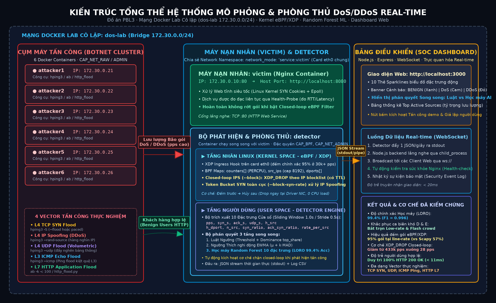
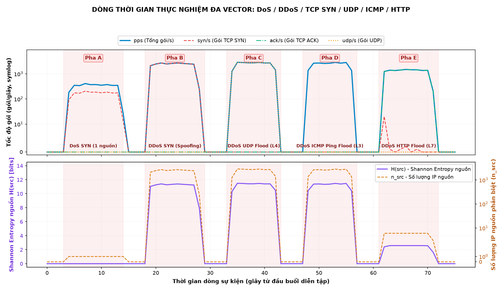
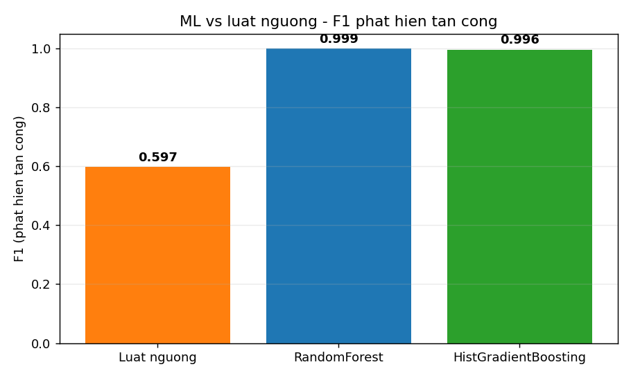
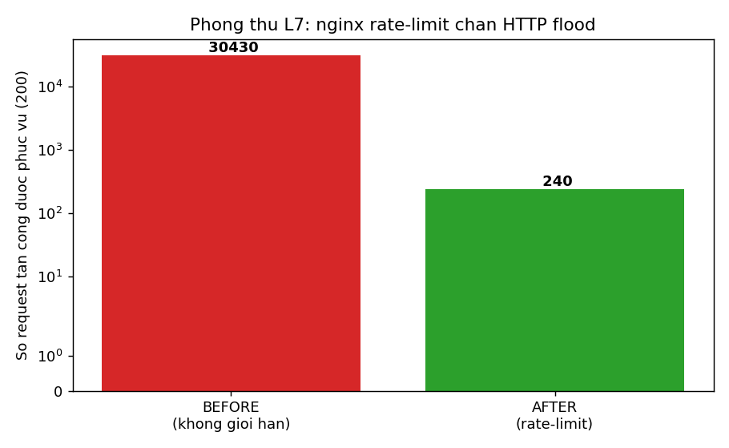

# Tài liệu lý thuyết: Tấn công và phát hiện DoS/DDoS

> Tài liệu nội bộ nhóm – Đồ án PBL3 (Đại học Bách khoa Đà Nẵng).
> Mục đích: giúp các thành viên nắm nền tảng lý thuyết trước khi đọc mã nguồn và bảo vệ đồ án.
> Bản Word tải về: [`TaiLieu_LyThuyet_DoS_DDoS.docx`](../TaiLieu_LyThuyet_DoS_DDoS.docx).

> ⚠️ **Chỉ dùng cho giáo dục trong lab cô lập.** Mọi tấn công chỉ nhắm vào máy `victim` của lab,
> tuyệt đối không nhắm tới hệ thống thật.

## Mục lục
1. [Giới thiệu đề tài](#1-giới-thiệu-đề-tài)
2. [DoS và DDoS – khái niệm nền tảng](#2-dos-và-ddos--khái-niệm-nền-tảng)
3. [Các kỹ thuật tấn công](#3-các-kỹ-thuật-tấn-công)
4. [Kiến trúc hệ thống lab](#4-kiến-trúc-hệ-thống-lab)
5. [Nguyên lý phát hiện](#5-nguyên-lý-phát-hiện)
6. [Kết quả minh họa](#6-kết-quả-minh-họa)
7. [Ngưỡng thích nghi (nâng cao)](#7-ngưỡng-thích-nghi-nâng-cao)
8. [So sánh với state-of-the-art](#8-so-sánh-với-state-of-the-art)
9. [Phòng thủ L7 (mitigation)](#9-phòng-thủ-l7-mitigation)
10. [Giới hạn & hướng phát triển](#10-giới-hạn--hướng-phát-triển)
11. [Thuật ngữ nhanh](#11-thuật-ngữ-nhanh)

---

## 1. Giới thiệu đề tài

Đề tài làm hai việc song song: (1) **mô phỏng** tấn công từ chối dịch vụ DoS/DDoS, và (2) xây dựng
bộ **phát hiện** (detector) nhận biết và phân loại tấn công theo thời gian thực. Tất cả chạy trong
một phòng lab ảo hóa bằng Docker, cô lập hoàn toàn với mạng thật.

Điểm cốt lõi khi trình bày: **lab cô lập, không nhắm target thật** — vừa là yêu cầu đạo đức, vừa là
điều cần nhấn mạnh khi bảo vệ.

## 2. DoS và DDoS – khái niệm nền tảng

- **DoS (Denial of Service):** làm dịch vụ quá tải/cạn tài nguyên khiến người dùng hợp lệ không truy
  cập được. Tấn công từ **một** nguồn.
- **DDoS (Distributed DoS):** cùng mục tiêu nhưng từ **nhiều** nguồn phân tán (botnet) → mạnh hơn,
  khó chặn hơn.

Khác biệt cốt lõi là **số nguồn tấn công** — cũng chính là tiêu chí bộ phát hiện dùng để phân loại.
Mục tiêu chung: làm cạn một loại tài nguyên (băng thông, CPU/bộ nhớ, hoặc bảng kết nối).

| Tiêu chí | DoS | DDoS |
|---|---|---|
| Số nguồn | 1 máy | Nhiều máy, phân tán |
| Độ mạnh | Giới hạn bởi 1 máy | Cộng dồn nhiều máy → rất lớn |
| Khó ngăn chặn | Dễ hơn (chặn 1 IP) | Khó (chặn hàng loạt IP) |
| Trong project | Kịch bản A | Kịch bản B, C |

Phân loại theo tầng mạng: **tầng 3/4** (gây ngập gói, cạn băng thông/bảng kết nối — ví dụ SYN flood)
và **tầng 7** (tấn công ứng dụng bằng yêu cầu hợp lệ số lượng lớn — ví dụ HTTP flood).

## 3. Các kỹ thuật tấn công

### 3.1. SYN flood – tầng 4 (L4)

TCP thiết lập kết nối qua **bắt tay ba bước**: client gửi `SYN` → server đáp `SYN-ACK` → client gửi
`ACK`. SYN flood khai thác bằng cách gửi thật nhiều `SYN` nhưng **không bao giờ gửi ACK cuối**; server
giữ mỗi kết nối ở trạng thái **half-open** trong bảng kết nối. Bảng đầy → từ chối kết nối hợp lệ.

**IP spoofing:** giả mạo IP nguồn ngẫu nhiên cho từng gói → `SYN-ACK` đi vô định, và lưu lượng từ
một máy trông như đến từ rất nhiều nguồn (giả lập DDoS). Trong project: [`attacks/syn_flood.py`](../attacks/syn_flood.py)
(scapy), tùy chọn `--spoof`. Dấu hiệu: nhiều SYN nhưng gần như không có ACK phản hồi.

### 3.2. HTTP flood – tầng 7 (L7)

Gửi nhiều yêu cầu HTTP **hợp lệ** (GET) tới server. Vì là kết nối thật (hoàn tất bắt tay TCP) nên khó
phân biệt với người dùng thật hơn; server tốn CPU xử lý từng yêu cầu. Trong project:
[`attacks/http_flood.py`](../attacks/http_flood.py) (đa luồng). Vì kết nối hoàn chỉnh nên lưu lượng
có rất nhiều `ACK` — đặc điểm **ACK ≫ SYN** giúp phân biệt L7 với SYN flood L4.

| Tiêu chí | SYN flood (L4) | HTTP flood (L7) |
|---|---|---|
| Tầng | Giao vận (TCP) | Ứng dụng (HTTP) |
| Cơ chế | Gửi SYN, bỏ dở bắt tay | Gửi nhiều GET hợp lệ |
| Tài nguyên bị cạn | Bảng kết nối half-open | CPU / xử lý ứng dụng |
| Dấu hiệu | ACK ≈ 0 (half-open) | ACK ≫ SYN (kết nối thật) |

## 4. Kiến trúc hệ thống lab



Mạng cô lập `dos-lab` (`172.30.0.0/24`): `victim` (nginx, .10), ba `attacker` (.21/.22/.23, có scapy +
hping3), và `detector`. Detector chạy `network_mode: service:victim` → **dùng chung namespace mạng với
victim**, nên thấy đúng lưu lượng victim thấy (dẫn tới lưu ý quan trọng ở mục 5.6).

## 5. Nguyên lý phát hiện

### 5.1. Ý tưởng chung
Detector chia thời gian thành **cửa sổ 1 giây**, đếm đặc trưng lưu lượng, so ngưỡng để quyết định có
tấn công không và thuộc loại nào.

### 5.2. Các đặc trưng
- **pps** (packets/s): mức tải chung.
- **syn/s**: cao bất thường → dấu hiệu SYN flood.
- **ack/s**: dùng phân biệt L4 với L7.
- **n_src**: số IP nguồn khác nhau → tiêu chí phân loại DoS/DDoS.

### 5.3. Entropy nguồn – H(src)
Entropy Shannon đo mức **phân tán** của lưu lượng trên các nguồn:

`H(src) = −Σ pᵢ · log₂(pᵢ)`  với `pᵢ` = tỉ lệ gói đến từ nguồn thứ i.

Entropy càng cao → lưu lượng càng rải đều trên nhiều nguồn.

| Tình huống | Phân bố | H(src) |
|---|---|---|
| 1 nguồn (DoS) | toàn bộ từ 1 IP | 0.00 |
| 3 nguồn đều | log₂(3) | ≈ 1.58 |
| ~64 nguồn giả mạo | log₂(64) | ≈ 6.00 |

### 5.4. Phân loại DoS/DDoS
Dựa **số nguồn**: `n_src = 1` → **DoS**; `n_src ≥ 2` → **DDoS**. Entropy báo kèm như thước đo phân tán.

### 5.5. Nhận diện SYN flood
Khi `syn/s ≥ ngưỡng` **và** `ack/s < syn/s × 0.2` → gắn nhãn `[SYN flood]` (half-open ít ACK trả về).

### 5.6. Lưu ý then chốt – chỉ đếm gói "đi vào" victim
Vì detector chung namespace với victim, nó thấy **cả hai chiều**. Nếu đếm cả gói victim tự trả về
(`SYN-ACK`, nguồn = victim) thì tấn công 1 nguồn bị tính thành 2 nguồn → **nhầm DoS thành DDoS**, và
`ack` bị thổi phồng làm nhãn `[SYN flood]` không kích hoạt. **Khắc phục:** chỉ đếm gói có đích = victim
(tham số `--victim`). Sau sửa: kịch bản A cho `n_src=1, ack=0` → nhận đúng **DoS [SYN flood]**.

## 6. Kết quả minh họa

Ba kịch bản chuẩn, số liệu thật từ lab (detection time ≈ 0s, không báo động giả):

| Kịch bản | pps | syn/s | ack/s | n_src | H(src) | Nhãn detector |
|---|---|---|---|---|---|---|
| A – 1 nguồn SYN | 58 | 29 | 0 | 1 | 0.00 | DoS `[SYN flood]` |
| B – 3 nguồn SYN + spoof | 132 | 66 | 0 | 66 | 6.04 | DDoS `[SYN flood]` |
| C – 3 nguồn HTTP (L7) | 2196 | 607 | 1639 | 3 | 1.58 | DDoS |



Đọc đồ thị: vùng SYN flood có `ack/s ≈ 0` (half-open); vùng HTTP flood có `ack/s` rất cao (ACK ≫ SYN).
`n_src` và `H(src)` tăng vọt ở kịch bản SYN có giả mạo IP — đúng bản chất phân tán của DDoS.

**Vì sao DDoS mà `n_src` chỉ bằng 3?** Lab chỉ có **3 máy tấn công** (attacker1/2/3), nên một DDoS
"nhiều nguồn thật" chỉ hiện tối đa 3 IP nguồn (kịch bản C). Detector phân loại DDoS khi `n_src ≥ 2`,
nên 3 nguồn đã đủ minh họa khác biệt DoS/DDoS. Muốn mô phỏng **hàng chục–hàng trăm nguồn** như botnet
thật thì dùng **giả mạo IP** (`--spoof`, kịch bản B → `n_src ≈ 66`) — nhưng chỉ làm được với SYN flood
(L4, không cần bắt tay); HTTP flood (L7) phải hoàn tất bắt tay TCP nên IP nguồn **bắt buộc là thật**,
do đó kịch bản C luôn chỉ 3 nguồn. Đây là **giới hạn của lab** (mục 10), không phải lỗi phát hiện.

## 7. Ngưỡng thích nghi (nâng cao)

Ngưỡng **cố định** (pps≥40, syn≥25) đơn giản nhưng yếu khi lưu lượng hợp lệ **biến thiên theo thời
gian** (giờ cao điểm, flash crowd): đặt thấp thì báo động giả, đặt cao thì bỏ lọt tấn công.

Giải pháp: **ngưỡng thích nghi** bằng **EWMA** (trung bình trượt mũ). Detector học baseline và đặt
ngưỡng động:

```
ngưỡng = max( μ + k·MAD , sàn tối thiểu )
```
- `μ` (EWMA trung bình) và `MAD` (EWMA độ lệch tuyệt đối) cập nhật mỗi giây: `μ ← α·x + (1−α)·μ`.
- Chỉ **học baseline khi KHÔNG báo động** → tránh "nhiễm độc" baseline bằng lưu lượng tấn công.
- `k` điều chỉnh độ nhạy (mặc định 4); `sàn tối thiểu` tránh quá nhạy khi baseline ≈ 0.

Bật bằng cờ `--adaptive` trong [`detection/detector.py`](../detection/detector.py).

**Thí nghiệm so sánh** (baseline hợp lệ trôi 100→300 pps, có một đợt tấn công lúc baseline còn thấp):


| Phương pháp | Bắt tấn công? | False positive |
|---|---|---|
| Fixed thấp (200) | CÓ | **86** (báo giả lúc lưu lượng hợp lệ cao) |
| Fixed cao (320) | **TRƯỢT** | 0 |
| **Adaptive EWMA** | **CÓ** | **1** |

Kết luận: **không có ngưỡng cố định nào thắng cả hai**; ngưỡng thích nghi vừa bắt được tấn công vừa
gần như không báo động giả vì nó bám theo baseline. (Tái lập: `python experiments/adaptive_eval.py`.)

## 8. So sánh với state-of-the-art

Thành thật: phương pháp hiện tại là **kinh điển/nền tảng**, phù hợp đồ án, **không phải SOTA**.

**Phía tấn công:**

| Project có | Thực tế / SOTA còn có |
|---|---|
| SYN flood, HTTP GET flood | Reflection/Amplification (DNS, NTP, memcached — khuếch đại hàng nghìn lần) |
| HTTP flood 1 URL | HTTP/2 Rapid Reset (CVE-2023-44487), Slowloris/slow-read, giả browser thật |
| 3 container | Botnet IoT (Mirai), pulse-wave, carpet-bombing, đa vector |

**Phía phát hiện:**

| Project có | SOTA |
|---|---|
| Ngưỡng cố định → **ngưỡng thích nghi (EWMA)** ✅ đã thêm | CUSUM, change-point detection đa cửa sổ |
| Sniff từng gói tại victim | Flow-based (NetFlow/sFlow), eBPF/XDP chặn ở line-rate trong kernel |
| Luật if-else + entropy → **RF/HistGB trên CICDDoS2019 thật** ✅ đã thêm | XGBoost, CNN/LSTM, autoencoder, phát hiện theo flow online |
| Chỉ phát hiện | Phát hiện + tự động giảm thiểu (IPS, SDN) |

### 8.1. Thử nghiệm ML trên CICDDoS2019 thật (đã làm)

Đã dựng pipeline ML trong [`ml/`](../ml/): huấn luyện **RandomForest** và **HistGradientBoosting**
trên đặc trưng flow, so với **luật ngưỡng 1 đặc trưng** (baseline mô phỏng chính detector luật của dự
án). Chạy trên **bộ dữ liệu CICDDoS2019 thật** (bản đã làm sạch `dhoogla/cicddos2019`, tải qua
`kagglehub`, định dạng parquet, ~131k flow × 63 đặc trưng, 13 họ tấn công). Nếu không tải dữ liệu,
`ml/make_synthetic.py` tạo bộ mẫu kiểu-CICDDoS2019 để pipeline vẫn chạy được ngay.

**Phát hiện tấn công (nhị phân: tấn công vs hợp lệ)** — đúng việc mà detector luật đang làm:

| Phương pháp | F1 phát hiện tấn công |
|---|---|
| Luật ngưỡng 1 đặc trưng (giống detector) | **0.60** |
| **RandomForest** | **0.999** |
| HistGradientBoosting | 0.996 |



Đây là **kết quả cốt lõi**: trên lưu lượng DDoS thật trộn nhiều loại, **một ngưỡng đơn lẻ là yếu**
(F1 0.60), còn mô hình học nhiều đặc trưng thì gần như hoàn hảo (0.999).

**Phân loại họ tấn công (13 lớp):** accuracy **0.93**, macro-F1 **0.735** (RandomForest).


Tấn công thể tích có dấu hiệu riêng thì dễ tách (NTP, TFTP, Syn, MSSQL, UDP đều ≥ 0.92 F1); nhóm UDP
reflection/amplification (DNS, LDAP, SNMP, Portmap, NetBIOS) chồng lấn đặc trưng ở mức flow nên vẫn
khó — đây là **giới hạn thật**, không giấu. Ngoài ra CICDDoS2019 gán nhãn cùng một họ theo **hai kiểu**
ở hai ngày chụp (`DrDoS_X` và `X`); `ml/train.py` **gom về họ chuẩn** (cờ `--raw-labels` để giữ nhãn
gốc — khi đó macro-F1 chỉ 0.54, phần sụt là do nhãn trùng chứ không phải mô hình kém).

Kết luận: ML dùng **nhiều đặc trưng** (kích thước gói, độ dài header, IAT, tỉ lệ fwd/bwd…) nên vượt xa
ngưỡng đơn ở việc phát hiện tấn công, và còn phân loại được *họ* tấn công. Tái lập: tải dữ liệu rồi
`python ml/train.py --data <thư mục parquet>` (hoặc `python ml/make_synthetic.py && python ml/train.py`).

## 9. Phòng thủ L7 (mitigation)

Detector mới chỉ **phát hiện** (IDS). Để **ngăn chặn** (IPS), đã thêm phòng thủ tầng 7: cấu hình
nginx **giới hạn tốc độ/kết nối theo từng IP** ([`mitigation/nginx/default.conf`](../mitigation/nginx/default.conf)):
mỗi IP tối đa ~10 request/giây (burst 20), vượt thì trả **429**. Client hợp lệ (tốc độ thấp) không
bị ảnh hưởng; flood từ một IP bị chặn gần hết nên server gần như không tốn sức.

**Demo before/after** (`python mitigation/demo_mitigation.py`) — HTTP flood 3 nguồn + 1 client hợp
lệ đo từ host:

| | BEFORE (không giới hạn) | AFTER (rate-limit) |
|---|---|---|
| Request tấn công được phục vụ (200) | 30,430 | **240** (~99% bị chặn) |
| Client hợp lệ: tỉ lệ 200 | 100% | 100% |
| Client hợp lệ: độ trễ | 16 ms | **6 ms** |



Điểm hay: sau khi bật phòng thủ, không chỉ chặn ~99% tấn công mà độ trễ của client hợp lệ còn
**giảm** (server không phí sức xử lý flood). Lưu ý: rate-limit theo IP **không** chống được SYN flood
có giả mạo IP (mỗi gói một IP khác) — loại đó cần SYN cookies / giới hạn ở tầng 4 / chặn thượng nguồn.

## 10. Giới hạn & hướng phát triển

**Giới hạn:**
- Một máy giả mạo nhiều IP **không phân biệt được** với nhiều máy thật từ phía victim.
- Ngưỡng nhạy với **flash crowd** (giảm nhờ ngưỡng thích nghi) và bỏ sót **low-and-slow** (Slowloris).
- Entropy phụ thuộc baseline và độ dài cửa sổ. Phát hiện **host-based** tại victim; tấn công thể tích
  lớn phải chặn ở thượng nguồn (firewall/CDN/scrubbing).

**Hướng phát triển:** (1) CUSUM/change-point; (2) **ML với CICDDoS2019** (đã làm mục 8.1);
(3) thêm vector low-and-slow; (4) mitigation L7 đã làm (mục 9) — còn SYN cookies/giới hạn L4 và
closed-loop (detector tự kích hoạt chặn).

## 11. Thuật ngữ nhanh

| Thuật ngữ | Giải thích |
|---|---|
| DoS / DDoS | Tấn công từ chối dịch vụ, từ một / nhiều nguồn |
| SYN / ACK | Các cờ trong bắt tay ba bước TCP |
| Half-open | Kết nối TCP dở dang do thiếu ACK cuối |
| IP spoofing | Giả mạo địa chỉ IP nguồn |
| pps / syn/s / ack/s | Số gói / gói SYN / gói ACK mỗi giây |
| Entropy H(src) | Độ phân tán của lưu lượng trên các nguồn |
| EWMA / MAD | Trung bình trượt mũ / độ lệch tuyệt đối trung bình (ngưỡng thích nghi) |
| L4 / L7 | Tầng giao vận / tầng ứng dụng |
| Baseline | Mức lưu lượng nền khi mạng bình thường |
