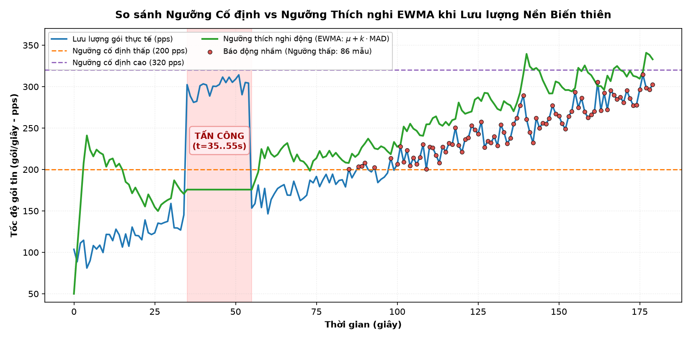
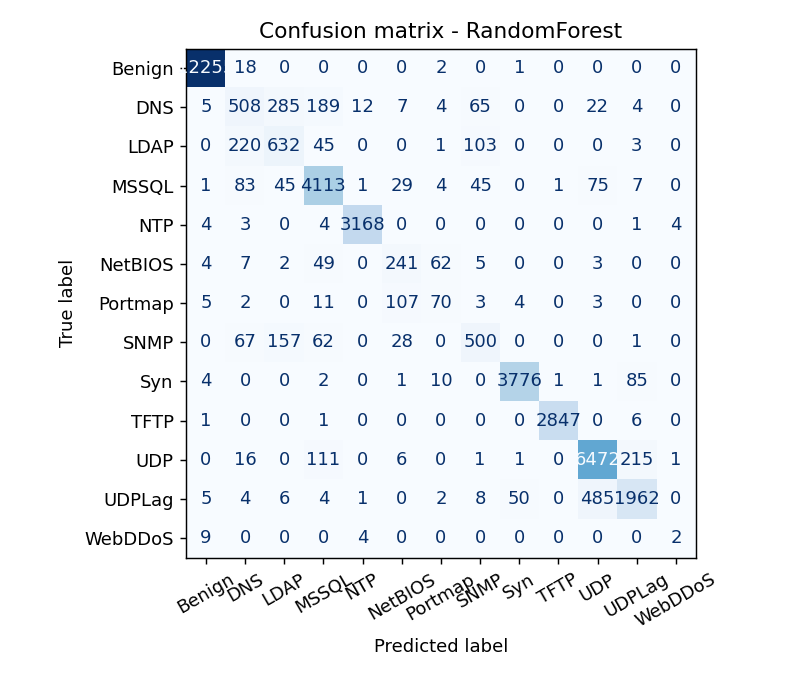

# Tài liệu lý thuyết: Tấn công và phát hiện DoS/DDoS

> Tài liệu nội bộ nhóm – Đồ án PBL3 (Đại học Bách khoa Đà Nẵng).
> Mục đích: giúp các thành viên nắm nền tảng lý thuyết trước khi đọc mã nguồn và bảo vệ đồ án.
> Bản Word tải về: [`TaiLieu_LyThuyet_DoS_DDoS.docx`](../TaiLieu_LyThuyet_DoS_DDoS.docx).

> ⚠️ **Chỉ dùng cho giáo dục trong lab cô lập.** Mọi tấn công chỉ nhắm vào máy `victim` của lab,
> tuyệt đối không nhắm tới hệ thống thật.

## Mục lục
1. [Giới thiệu đề tài](#1-giới-thiệu-đề-tài)
2. [DoS và DDoS – khái niệm nền tảng](#2-dos-và-ddos--khái-niệm-nền-tảng)
3. [Các kỹ thuật tấn công](#3-các-kỹ-thuật-tấn-công)
4. [Kiến trúc hệ thống lab](#4-kiến-trúc-hệ-thống-lab)
5. [Nguyên lý phát hiện](#5-nguyên-lý-phát-hiện)
6. [Kết quả minh họa](#6-kết-quả-minh-họa)
7. [Ngưỡng thích nghi (nâng cao)](#7-ngưỡng-thích-nghi-nâng-cao)
8. [So sánh với state-of-the-art](#8-so-sánh-với-state-of-the-art)
9. [Phòng thủ: closed-loop (XDP drop)](#9-phòng-thủ-closed-loop-xdp-drop)
10. [Cường độ tối đa & tác động thật lên dịch vụ](#10-cường-độ-tối-đa--tác-động-thật-lên-dịch-vụ)
11. [Giới hạn & hướng phát triển](#11-giới-hạn--hướng-phát-triển)
12. [Thuật ngữ nhanh](#12-thuật-ngữ-nhanh)

---

## 1. Giới thiệu đề tài

Đề tài làm hai việc song song: (1) **mô phỏng** tấn công từ chối dịch vụ DoS/DDoS, và (2) xây dựng
bộ **phát hiện** (detector) nhận biết và phân loại tấn công theo thời gian thực. Tất cả chạy trong
một phòng lab ảo hóa bằng Docker, cô lập hoàn toàn với mạng thật.

Điểm cốt lõi khi trình bày: **lab cô lập, không nhắm target thật** — vừa là yêu cầu đạo đức, vừa là
điều cần nhấn mạnh khi bảo vệ.

## 2. DoS và DDoS – khái niệm nền tảng

- **DoS (Denial of Service):** làm dịch vụ quá tải/cạn tài nguyên khiến người dùng hợp lệ không truy
  cập được. Tấn công từ **một** nguồn.
- **DDoS (Distributed DoS):** cùng mục tiêu nhưng từ **nhiều** nguồn phân tán (botnet) → mạnh hơn,
  khó chặn hơn.

Khác biệt cốt lõi là **số nguồn tấn công** — cũng chính là tiêu chí bộ phát hiện dùng để phân loại.
Mục tiêu chung: làm cạn một loại tài nguyên (băng thông, CPU/bộ nhớ, hoặc bảng kết nối).

| Tiêu chí | DoS | DDoS |
|---|---|---|
| Số nguồn | 1 máy | Nhiều máy, phân tán |
| Độ mạnh | Giới hạn bởi 1 máy | Cộng dồn nhiều máy → rất lớn |
| Khó ngăn chặn | Dễ hơn (chặn 1 IP) | Khó (chặn hàng loạt IP) |
| Trong project | Kịch bản A | Kịch bản B, C |

Phân loại theo tầng mạng: **tầng 3/4** (gây ngập gói, cạn băng thông/bảng kết nối — ví dụ SYN flood)
và **tầng 7** (tấn công ứng dụng bằng yêu cầu hợp lệ số lượng lớn — ví dụ HTTP flood).

## 3. Các kỹ thuật tấn công

### 3.1. SYN flood – tầng 4 (L4)

TCP thiết lập kết nối qua **bắt tay ba bước**: client gửi `SYN` → server đáp `SYN-ACK` → client gửi
`ACK`. SYN flood khai thác bằng cách gửi thật nhiều `SYN` nhưng **không bao giờ gửi ACK cuối**; server
giữ mỗi kết nối ở trạng thái **half-open** trong bảng kết nối. Bảng đầy → từ chối kết nối hợp lệ.

**IP spoofing:** giả mạo IP nguồn ngẫu nhiên cho từng gói → `SYN-ACK` đi vô định, và lưu lượng từ
một máy trông như đến từ rất nhiều nguồn (giả lập DDoS). Trong project: [`attacks/syn_flood.py`](../attacks/syn_flood.py)
(scapy), tùy chọn `--spoof`. Dấu hiệu: nhiều SYN nhưng gần như không có ACK phản hồi.

### 3.2. HTTP flood – tầng 7 (L7)

Gửi nhiều yêu cầu HTTP **hợp lệ** (GET) tới server. Vì là kết nối thật (hoàn tất bắt tay TCP) nên khó
phân biệt với người dùng thật hơn; server tốn CPU xử lý từng yêu cầu. Trong project:
[`attacks/http_flood.py`](../attacks/http_flood.py) (đa luồng). Vì kết nối hoàn chỉnh nên lưu lượng
có rất nhiều `ACK` — đặc điểm **ACK ≫ SYN** giúp phân biệt L7 với SYN flood L4.

| Tiêu chí | SYN flood (L4) | HTTP flood (L7) |
|---|---|---|
| Tầng | Giao vận (TCP) | Ứng dụng (HTTP) |
| Cơ chế | Gửi SYN, bỏ dở bắt tay | Gửi nhiều GET hợp lệ |
| Tài nguyên bị cạn | Bảng kết nối half-open | CPU / xử lý ứng dụng |
| Dấu hiệu | ACK ≈ 0 (half-open) | ACK ≫ SYN (kết nối thật) |

## 4. Kiến trúc hệ thống lab


Mạng cô lập `dos-lab` (`172.30.0.0/24`): `victim` (nginx, .10), sáu `attacker` (.21–.26, có scapy +
hping3), và `detector`. Detector chạy `network_mode: service:victim` → **dùng chung namespace mạng với
victim**, nên thấy đúng lưu lượng victim thấy (dẫn tới lưu ý quan trọng ở mục 5.6).

## 5. Nguyên lý phát hiện

### 5.1. Ý tưởng chung
Detector chia thời gian thành **cửa sổ 1 giây**, đếm đặc trưng lưu lượng, so ngưỡng để quyết định có
tấn công không và thuộc loại nào.

**Bộ đếm cắm được (`--engine`).** Mặc định dùng **scapy** (`sniff` trong một luồng nền) — đơn giản nhưng
ở tốc độ gói cao thì **userspace Python xử lý không kịp và rớt gói**. Tùy chọn **`--engine ebpf`** gắn một
chương trình **XDP ingress** (BCC, `detection/ebpf_counter.py`) vào `eth0` trong netns victim: nó đếm thẳng
trong nhân vào các BPF maps (packets/syn/ack + bảng băm `src_ip`, `dport`) và **luôn trả `XDP_PASS` — chỉ
đếm, KHÔNG chặn gói**. Hai backend trả về cùng bộ số cho mỗi cửa sổ nên phần còn lại (ngưỡng, entropy,
`--adaptive`, `--ml`) giữ nguyên. Thử nghiệm bắn 120.000 gói tốc độ cao: scapy chỉ quan sát được **~57%**
(trần xử lý ~6.9k pps), còn XDP quan sát **~95%** và thấy đúng đỉnh thật ~30k pps — bằng chứng eBPF đếm
chính xác ở line-rate. (Cần quyền `CAP_BPF`/`CAP_NET_ADMIN` + kernel headers; xem `docker-compose.yml`.)

### 5.2. Các đặc trưng
- **pps** (packets/s): mức tải chung.
- **syn/s**: cao bất thường → dấu hiệu SYN flood.
- **ack/s**: dùng phân biệt L4 với L7.
- **n_src**: số IP nguồn khác nhau → tiêu chí phân loại DoS/DDoS.

### 5.3. Entropy nguồn – H(src)
Entropy Shannon đo mức **phân tán** của lưu lượng trên các nguồn:

`H(src) = −Σ pᵢ · log₂(pᵢ)`  với `pᵢ` = tỉ lệ gói đến từ nguồn thứ i.

Entropy càng cao → lưu lượng càng rải đều trên nhiều nguồn.

| Tình huống | Phân bố | H(src) |
|---|---|---|
| 1 nguồn (DoS) | toàn bộ từ 1 IP | 0.00 |
| 6 nguồn thật đều (kịch bản C) | log₂(6) | ≈ 2.58 |
| ~2300 nguồn giả mạo (kịch bản B) | log₂(2300) | ≈ 11.2 |

### 5.4. Phân loại DoS/DDoS
Dựa **số nguồn**: `n_src = 1` → **DoS**; `n_src ≥ 2` → **DDoS**. Entropy báo kèm như thước đo phân tán.

### 5.5. Nhận diện SYN flood
Khi `syn/s ≥ ngưỡng` **và** `ack/s < syn/s × 0.2` → gắn nhãn `[SYN flood]` (half-open ít ACK trả về).

### 5.6. Lưu ý then chốt – chỉ đếm gói "đi vào" victim
Vì detector chung namespace với victim, nó thấy **cả hai chiều**. Nếu đếm cả gói victim tự trả về
(`SYN-ACK`, nguồn = victim) thì tấn công 1 nguồn bị tính thành 2 nguồn → **nhầm DoS thành DDoS**, và
`ack` bị thổi phồng làm nhãn `[SYN flood]` không kích hoạt. **Khắc phục:** chỉ đếm gói có đích = victim
(tham số `--victim`). Sau sửa: kịch bản A cho `n_src=1, ack=0` → nhận đúng **DoS [SYN flood]**.

## 6. Kết quả minh họa

Ba kịch bản chuẩn, số liệu thật từ lab (detection time ≈ 0s, không báo động giả):

| Kịch bản | pps | syn/s | ack/s | n_src | H(src) | Nhãn detector |
|---|---|---|---|---|---|---|
| A – 1 nguồn SYN | ~300 | ~150 | 0 | 1 | 0.00 | DoS `[SYN flood]` |
| B – 6 nguồn SYN + spoof | ~4000 | ~2000 | 0 | **~2300** | ~11.1 | DDoS `[SYN flood]` |
| C – 6 nguồn HTTP (L7) | ~1800 | ~400 | ~1400 | 6 | ~2.58 | DDoS |


Đọc đồ thị: vùng SYN flood có `ack/s ≈ 0` (half-open); vùng HTTP flood có `ack/s` rất cao (ACK ≫ SYN).
`n_src` và `H(src)` tăng vọt ở kịch bản SYN có giả mạo IP — đúng bản chất phân tán của DDoS.

**Vì sao số nguồn `n_src` khác nhau giữa B và C?** Lab có **6 máy tấn công** (attacker1–6). HTTP flood
(L7, kịch bản C) phải **hoàn tất bắt tay TCP** nên IP nguồn **bắt buộc là thật** → số nguồn = số
container = **6**. SYN flood (L4, kịch bản B) **không cần bắt tay** nên có thể **giả mạo IP** (`--spoof`):
mỗi gói một IP `10.x.x.x` ngẫu nhiên, bắn tốc độ cao thì một cửa sổ 1 giây chứa **hàng nghìn IP nguồn
khác nhau** (đo được `n_src ≈ 2300`, `H(src) ≈ 11`). Detector phân loại DDoS khi `n_src ≥ 2`. Điểm mấu
chốt: **spoofing chỉ mô phỏng được nhiều nguồn ở tầng 4**, còn tầng 7 giới hạn ở số máy thật — một đặc
điểm của lab (mục 10), không phải lỗi phát hiện.

## 7. Ngưỡng thích nghi (nâng cao)

Ngưỡng **cố định** (pps≥40, syn≥25) đơn giản nhưng yếu khi lưu lượng hợp lệ **biến thiên theo thời
gian** (giờ cao điểm, flash crowd): đặt thấp thì báo động giả, đặt cao thì bỏ lọt tấn công.

Giải pháp: **ngưỡng thích nghi** bằng **EWMA** (trung bình trượt mũ). Detector học baseline và đặt
ngưỡng động:

```
ngưỡng = max( μ + k·MAD , sàn tối thiểu )
```
- `μ` (EWMA trung bình) và `MAD` (EWMA độ lệch tuyệt đối) cập nhật mỗi giây: `μ ← α·x + (1−α)·μ`.
- Chỉ **học baseline khi KHÔNG báo động** → tránh "nhiễm độc" baseline bằng lưu lượng tấn công.
- `k` điều chỉnh độ nhạy (mặc định 4); `sàn tối thiểu` tránh quá nhạy khi baseline ≈ 0.

Bật bằng cờ `--adaptive` trong [`detection/detector.py`](../detection/detector.py).

**Thí nghiệm so sánh** (baseline hợp lệ trôi 100→300 pps, có một đợt tấn công lúc baseline còn thấp):



| Phương pháp | Bắt tấn công? | False positive |
|---|---|---|
| Fixed thấp (200) | CÓ | **86** (báo giả lúc lưu lượng hợp lệ cao) |
| Fixed cao (320) | **TRƯỢT** | 0 |
| **Adaptive EWMA** | **CÓ** | **1** |

Kết luận: **không có ngưỡng cố định nào thắng cả hai**; ngưỡng thích nghi vừa bắt được tấn công vừa
gần như không báo động giả vì nó bám theo baseline. (Tái lập: `python experiments/adaptive_eval.py`.)

## 8. So sánh với state-of-the-art

Thành thật: phương pháp hiện tại là **kinh điển/nền tảng**, phù hợp đồ án, **không phải SOTA**.

**Phía tấn công:**

| Project có | Thực tế / SOTA còn có |
|---|---|
| SYN flood, HTTP GET flood | Reflection/Amplification (DNS, NTP, memcached — khuếch đại hàng nghìn lần) |
| HTTP flood 1 URL | HTTP/2 Rapid Reset (CVE-2023-44487), Slowloris/slow-read, giả browser thật |
| 3 container | Botnet IoT (Mirai), pulse-wave, carpet-bombing, đa vector |

**Phía phát hiện:**

| Project có | SOTA |
|---|---|
| Ngưỡng cố định → **ngưỡng thích nghi (EWMA)** ✅ đã thêm | CUSUM, change-point detection đa cửa sổ |
| Sniff từng gói tại victim | Flow-based (NetFlow/sFlow), eBPF/XDP chặn ở line-rate trong kernel |
| Luật if-else + entropy → **RF/HistGB trên CICDDoS2019 thật** ✅ đã thêm | XGBoost, CNN/LSTM, autoencoder, phát hiện theo flow online |
| Chỉ phát hiện | Phát hiện + tự động giảm thiểu (IPS, SDN) |

### 8.1. Thử nghiệm ML trên CICDDoS2019 thật (đã làm)

#### CICDDoS2019 là gì?

Đây là **bộ dữ liệu chuẩn (benchmark)** về DDoS do Viện An ninh mạng Canada (CIC, Đại học New
Brunswick) công bố năm 2019 — một trong những bộ được trích dẫn nhiều nhất trong nghiên cứu phát hiện
DDoS. Đặc điểm:

- Là **lưu lượng mạng thật** đã bắt và gán nhãn, gồm lưu lượng **hợp lệ (Benign)** và ~13 **họ tấn
  công** thật — phần lớn là reflection/amplification: NTP, DNS, LDAP, MSSQL, NetBIOS, SNMP, Portmap,
  UDP, SYN, TFTP, UDP-lag, WebDDoS.
- Mỗi dòng **không phải một gói**, mà là một **flow** (một luồng kết nối) được công cụ **CICFlowMeter**
  trích ~80 **đặc trưng thống kê**: kích thước gói (min/max/trung bình/độ lệch), thời gian giữa các gói
  (IAT), số cờ TCP (SYN/ACK/FIN/RST…), tỉ lệ chiều đi/về (fwd/bwd), độ dài header, số byte/giây…
- Dự án dùng bản đã làm sạch `dhoogla/cicddos2019` (định dạng parquet, tải qua `kagglehub`): sau khi bỏ
  cột định danh/hằng số còn **~131k flow × 63 đặc trưng số**.

#### Pipeline

Trong [`ml/`](../ml/): huấn luyện **RandomForest** và **HistGradientBoosting** trên đặc trưng flow, so
với một **luật ngưỡng 1 đặc trưng** — bản rút gọn **mô phỏng chính detector luật** của dự án (chọn
ngưỡng tối ưu trên 1 đặc trưng tốc độ). Không tải dữ liệu thì `ml/make_synthetic.py` tạo mẫu
kiểu-CICDDoS2019 để pipeline vẫn chạy được ngay.

**Phát hiện tấn công (nhị phân: tấn công vs hợp lệ)** — đúng việc mà detector luật đang làm:

| Phương pháp | F1 phát hiện tấn công |
|---|---|
| Luật ngưỡng 1 đặc trưng (giống detector) | **0.60** |
| **RandomForest** | **0.999** |
| HistGradientBoosting | 0.996 |


**Phân loại họ tấn công (13 lớp):** accuracy **0.93**, macro-F1 **0.735** (RandomForest).



#### Tác dụng của bước ML này (vì sao đồ án cần nó)

1. **Định lượng giới hạn của detector luật.** Detector đang chạy chỉ dựa trên **một** tiêu chí (ngưỡng
   `pps`/`syn`). Thí nghiệm đưa ra con số thẳng thắn: trên lưu lượng DDoS thật trộn nhiều loại, một
   ngưỡng đơn chỉ đạt **F1 0.60**, còn mô hình nhiều đặc trưng đạt **0.999**. Đây là bằng chứng *vì sao*
   luật ngưỡng có trần và *vì sao* nên tiến tới ML — không nói suông.

2. **Kiểm chứng trên dữ liệu chuẩn, khách quan.** Lab chỉ tự sinh 3 loại tấn công từ 3 máy — quá nhỏ để
   kết luận. CICDDoS2019 là dữ liệu mạng thật, có nhãn, công khai → kết quả **so sánh được với giới
   nghiên cứu**, không chỉ "chạy tốt trên lab của tôi".

3. **Giới thiệu mô hình phát hiện theo FLOW.** Detector luật **đếm gói theo cửa sổ 1 giây** (dựa lưu
   lượng tức thời). ML học **đặc trưng mức luồng** (kích thước gói, IAT, tỉ lệ fwd/bwd, số cờ…) — đúng
   cách các hệ IDS thật và SOTA hoạt động. Đây là một **mô hình phát hiện thứ hai**, giàu thông tin hơn
   cách đếm gói thuần.

4. **Phân loại được LOẠI tấn công.** Luật chỉ nói DoS/DDoS (kèm nhãn `[SYN flood]`). ML gọi tên được
   **13 họ tấn công** (accuracy 0.93) — mức chi tiết mà một ngưỡng không thể cho.

5. **Chỉ ra đặc trưng nào quan trọng.** RandomForest xếp hạng đặc trưng quan trọng nhất là **kích thước
   gói** (Packet Length Min, Avg Packet Size, Packet Length Mean) và **kích thước segment chiều đi**
   (Avg Fwd Segment Size, Fwd Packet Length Min/Max). Nghĩa là tấn công lộ ra chủ yếu ở **hình dạng/kích
   thước gói**, không chỉ ở số lượng gói — một hiểu biết về *bản chất*, không chỉ là điểm số.

6. **Trung thực về điểm yếu.** Kết quả đa lớp (macro-F1 0.735) cho thấy nhóm UDP reflection/amplification
   (DNS, LDAP, SNMP, Portmap, NetBIOS) **chồng lấn đặc trưng** ở mức flow nên khó tách rời — bản thân
   điều này là một *phát hiện*, cho thấy đồ án không thổi phồng kết quả. (Lưu ý thêm: CICDDoS2019 gán
   nhãn cùng một họ theo **hai kiểu** ở hai ngày chụp — `DrDoS_X` và `X`; `ml/train.py` **gom về họ
   chuẩn** mặc định. Cờ `--raw-labels` giữ nhãn gốc → macro-F1 tụt còn 0.54, phần sụt là do nhãn trùng
   chứ không phải mô hình kém.)

**Tóm lại:** ML CICDDoS2019 *không thay thế* detector đang chạy, mà là phần **nâng cao/đối chứng**: nó
chứng minh bằng dữ liệu thật rằng cách phát hiện bằng luật ngưỡng là bản đơn giản hoá có giới hạn rõ
rệt, và chỉ ra hướng đi mạnh hơn (phát hiện theo flow + học máy). Tái lập: tải dữ liệu rồi
`python ml/train.py --data <thư mục parquet>` (hoặc `python ml/make_synthetic.py && python ml/train.py`).

### 8.2. ML trực tiếp trên đặc trưng của detector (ML "live")

Mô hình CICDDoS2019 ở trên cần ~63 đặc trưng mức **flow**, trong khi detector chỉ có đặc trưng mức
**cửa sổ 1 giây** (`pps, syn/s, ack/s, H(src), H(dport), n_src`). Vì vậy để chạy ML **ngay trong
detector**, ta huấn luyện một mô hình mới trên **chính các đặc trưng đó**, dùng dữ liệu tự sinh từ lab:

- `ml/build_window_dataset.py` chạy lại các kịch bản (A..E, nhiều lần) và gán nhãn từng cửa sổ
  (`BENIGN` nếu `pps=0`, ngược lại là nhãn thật của kịch bản), thêm hai tỉ lệ dẫn xuất
  `syn_ratio = syn/pps` và `ack_syn_ratio = ack/syn`, rồi xuất `ml/data/windows.csv`.
- `ml/train_window.py` huấn luyện một **RandomForest đa lớp** (BENIGN/DoS/DDoS) và lưu vào
  `detection/window_model.joblib`.

**Hai kịch bản "gần ngưỡng" D và E** được thêm để phép so sánh có ý nghĩa (nếu chỉ có A/B/C thì ba lớp
tách nhau quá rạch ròi, ML đạt F1 = 1.000 — bài toán quá dễ):

- **D** — SYN spoof tốc độ thấp (~24 pps, dưới ngưỡng 40/25): là tấn công thật nhưng **luật bỏ sót**.
- **E** — một khách HTTP tải cao (flash-crowd nhẹ): lành tính nhưng vượt ngưỡng nên **luật báo nhầm**.

Kết quả trên tập 316 cửa sổ (chia 70/30): F1 phát hiện tấn công **luật 0.58 vs RF 0.99**; macro-F1 đa
lớp **0.59 vs 0.99**; riêng các cửa sổ tấn công **dưới ngưỡng**, luật bắt **0%** còn RF **100%**. Đánh
giá chặt hơn kiểu *leave-one-run-out* (mỗi lần giữ nguyên một lượt chạy làm test): F1 **luật 0.52 vs
RF 0.99**. RF **không** còn hoàn hảo (sai ~1 cửa sổ ở vùng biên); muốn nó sai nhiều hơn phải cho E là
flash-crowd **nhiều nguồn** trùng vùng với HTTP-DDoS — đúng bài toán kinh điển "flash crowd khó phân
biệt với DDoS".

Bật ML **trực tiếp** trong detector bằng cờ `--ml`:

```bash
docker exec -it detector python3 /app/detector.py --pps 40 --syn 25 \
    --victim 172.30.0.10 --ml /app/window_model.joblib
```

Detector nạp mô hình một lần lúc khởi động và với mỗi cửa sổ in **cả hai** phán quyết: của luật và của
ML (`ml_verdict` kèm độ tin `ml_conf`). Dashboard cũng hiển thị hai dòng `rule:` và `ML:` cạnh nhau,
tô màu theo từng bên nên thấy ngay khi chúng khác nhau. (Container detector đã cài sẵn
`scikit-learn 1.9.1 + joblib` trong `attacker/Dockerfile` để nạp được mô hình.)

## 9. Phòng thủ: closed-loop (XDP drop)

Dựa trên engine eBPF (mục 5.1), detector có thể **tự chặn** theo vòng kín "phát hiện → chặn"
(`--block`, mặc định tắt = chỉ phát hiện). Chương trình XDP **đếm trước rồi mới chặn** nên detector vẫn
thấy đúng cường độ tấn công đến.

- **Chặn theo nguồn (per-source):** mỗi cửa sổ, nguồn nào vượt `--block-pps` (vd 200) được ghi vào BPF
  map `blocklist` kèm **TTL** (`--block-ttl`, vd 5s — tự hết hạn, **không** chặn vĩnh viễn); gói từ nguồn
  đó trả `XDP_DROP`. Hiệu quả với tấn công **nguồn thật** (A, C).
- **Chặn theo tốc độ SYN toàn cục (`--block-syn-rate N`):** một token-bucket (`bpf_spin_lock`) drop SYN
  vượt `N`/giây bất kể nguồn — cách duy nhất cắt được **SYN spoof** (mỗi gói một IP ⇒ chặn per-source vô
  dụng).

**An toàn:** blocklist luôn có TTL tự hết hạn + giới hạn kích thước; client hợp lệ và health-probe (tốc
độ thấp ≪ `--block-pps`) không bị chặn nhầm; mặc định `--block` tắt.

**Kết quả demo (bật drop thật trong lab):**

| Kịch bản | Không chặn | Có chặn |
|---|---|---|
| C – 6 nguồn HTTP (có trạng thái) | ~136.000 pps vào victim | **~242 pps** (6 nguồn bị chặn; drop SYN → bắt tay không xong → attacker treo) |
| B – SYN spoof, chặn per-source | ~19.000 pps | **không đổi** (0 nguồn bị chặn — đúng giới hạn) |
| B – SYN spoof, `--block-syn-rate 2000` | ~25.900 pps | **drop ~85%** (còn ~3.800 pps tới nginx) |

Đánh đổi của chặn theo tốc độ SYN: một phần **SYN hợp lệ cũng bị rớt** khi tổng vượt ngưỡng — giới hạn
cố hữu khi phía victim không phân biệt được nguồn thật/giả.

## 10. Cường độ tối đa & tác động thật lên dịch vụ

Hai mức cường độ tấn công, chọn bằng `intensity` (run_scenarios.py `--intensity`, run_ddos.sh `-i`, hoặc
nút **Max intensity** trên dashboard):

- **paced** (mặc định): scapy/`http_flood.py` **có điều tiết tốc độ**. Tải vừa phải, ổn định, dùng để
  sinh **dataset ML** (mục 8.2) và minh họa phân loại. Giữ nguyên, không đổi.
- **max**: cường độ **tối đa (line-rate)** bằng công cụ chuyên dụng — `hping3` cho SYN flood
  (`--flood`, thêm `--rand-source` để giả mạo), `ab` (ApacheBench) cho L7 (`-k -c 500`). Chỉ áp dụng
  cho A/B/C và **bắt buộc engine eBPF** (scapy rớt gói nặng ở line-rate, không đếm kịp).

**Đo tác động thật** (detect-only, **không** bật chặn, để thấy sức tấn công thô): một **client hợp lệ
tốc độ thấp** (host → cổng publish của victim) đo độ trễ + tỉ lệ thành công, song song đọc bộ đếm gói
vào của `eth0` victim. Số liệu lab (host 20 core, 10.5 GB trống; mỗi trạng thái 8s):

| Trạng thái | Lưu lượng vào victim | Gói rớt (eth0 rx) | Client hợp lệ | Độ trễ p50/p95 |
|---|---|---|---|---|
| idle | ~28 pps | — | 30/30 OK | 1ms / 1ms |
| A-max (1 nguồn SYN `--flood`) | **~190k pps** | **0** | 37/37 OK | 1ms / 1ms |
| B-max (6 nguồn SYN spoof) | **~123k pps** | **0** | 36/36 OK | 0ms / 1ms |
| C-max (6 nguồn HTTP `ab -c 500`) | **~693k pps** | **0** | 35/35 OK | 1ms / **11ms** |

**Kết luận trung thực:** mặc định hiện đại (**SYN cookies** của kernel + nginx phục vụ nội dung tĩnh rất
nhanh) **hấp thụ sạch** cả ba tấn công — **không gói nào bị rớt ở eth0** kể cả ở 693k pps, client hợp lệ
**100% thành công** ở mọi trạng thái. Tác động nặng nhất chỉ là **đuôi độ trễ C-max tăng 1ms → 11ms**.
Muốn victim *sập* thật cần victim yếu hơn hoặc quy mô lớn hơn nhiều — **không thổi phồng** kết quả. Đây là
một kết luận hợp lệ: phòng thủ cơ bản (tuned kernel + reverse-proxy nhanh) đã đi được rất xa.

**Giá trị của phòng thủ (mục 9) ở đây** là **giảm khối lượng tấn công + tải host** và trả lại độ trễ về
mức nền, chứ không phải cứu một dịch vụ đã chết:

| Kịch bản max | Không chặn | Bật `--block` |
|---|---|---|
| A-max (SYN 1 nguồn) | ~190k pps | XDP drop **~100%** (`blocked_src`=1), client 39/39, p95 1ms |
| C-max (HTTP 6 nguồn) | 693k pps, p95 **11ms** | pps **~433k → ~28** (`blocked_src`=6), client 41/41, p95 **11ms → 1ms** |
| B-max (SYN spoof) | per-source vô dụng | `--block-syn-rate` cắt ~85% (mục 9) |

> **Lưu ý kỹ thuật (eBPF):** SYN flood spoof `--rand-source` sinh hàng chục nghìn IP khác nhau/giây. Map
> `src_ips` bị **chặn kích thước ở 8192** để userspace đọc/xóa map mỗi giây không bị khựng; bộ đếm
> packets/syn/ack nằm ở PERCPU array nên **cường độ vẫn chính xác**, chỉ `n_src` bão hòa ở ~8192 (vẫn rõ
> ràng là "rất nhiều nguồn" ⇒ DDoS, `H(src)≈13`).

## 11. Giới hạn & hướng phát triển

**Giới hạn:**
- Một máy giả mạo nhiều IP **không phân biệt được** với nhiều máy thật từ phía victim.
- Ngưỡng nhạy với **flash crowd** (giảm nhờ ngưỡng thích nghi) và bỏ sót **low-and-slow** (Slowloris).
- Entropy phụ thuộc baseline và độ dài cửa sổ. Phát hiện **host-based** tại victim; tấn công thể tích
  lớn phải chặn ở thượng nguồn (firewall/CDN/scrubbing).

**Hướng phát triển:** (1) CUSUM/change-point; (2) **ML với CICDDoS2019** (đã làm mục 8.1);
(3) thêm vector low-and-slow; (4) phòng thủ **closed-loop XDP drop** đã làm (mục 9) — còn SYN cookies
và chặn ở thượng nguồn (upstream/CDN) để xử spoof triệt để hơn.

## 12. Thuật ngữ nhanh

| Thuật ngữ | Giải thích |
|---|---|
| DoS / DDoS | Tấn công từ chối dịch vụ, từ một / nhiều nguồn |
| SYN / ACK | Các cờ trong bắt tay ba bước TCP |
| Half-open | Kết nối TCP dở dang do thiếu ACK cuối |
| IP spoofing | Giả mạo địa chỉ IP nguồn |
| pps / syn/s / ack/s | Số gói / gói SYN / gói ACK mỗi giây |
| Entropy H(src) | Độ phân tán của lưu lượng trên các nguồn |
| EWMA / MAD | Trung bình trượt mũ / độ lệch tuyệt đối trung bình (ngưỡng thích nghi) |
| L4 / L7 | Tầng giao vận / tầng ứng dụng |
| Baseline | Mức lưu lượng nền khi mạng bình thường |
